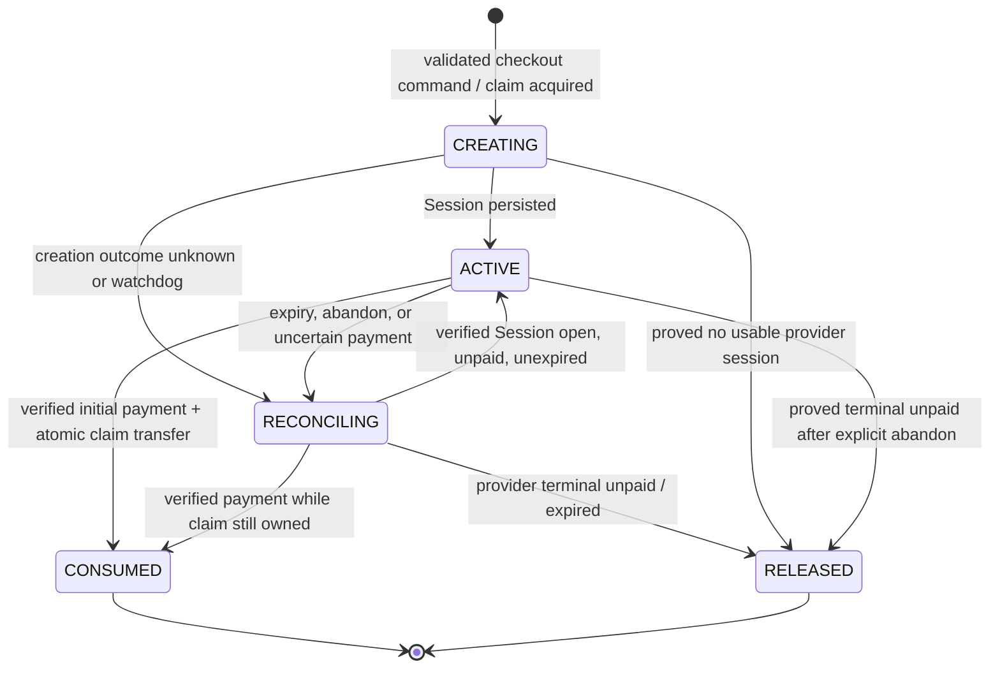
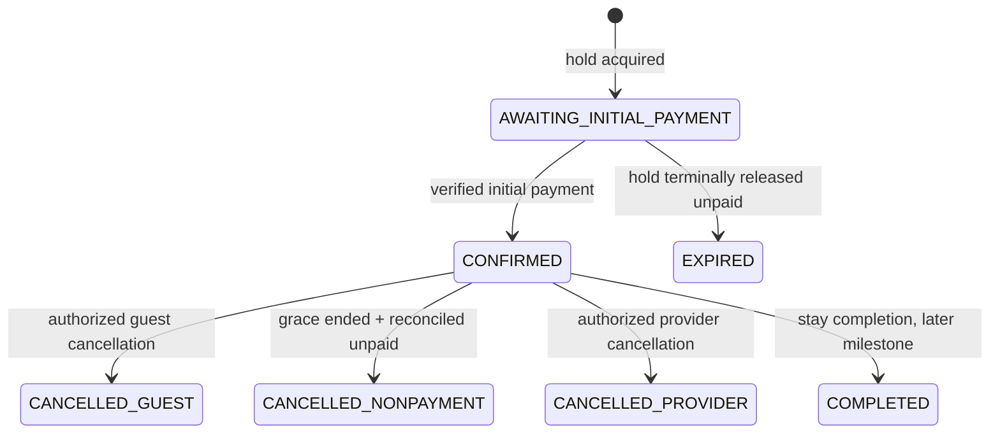
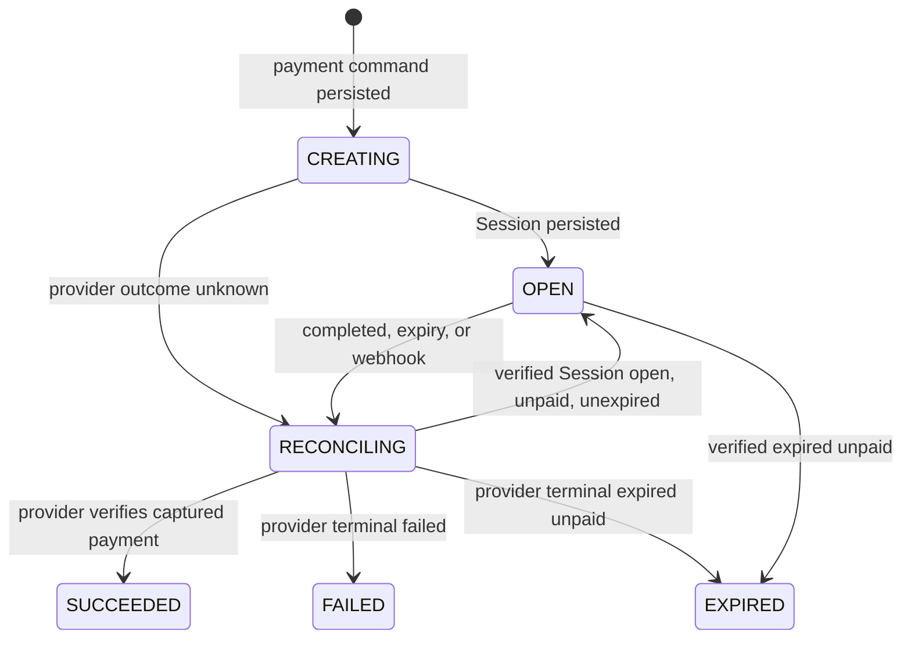
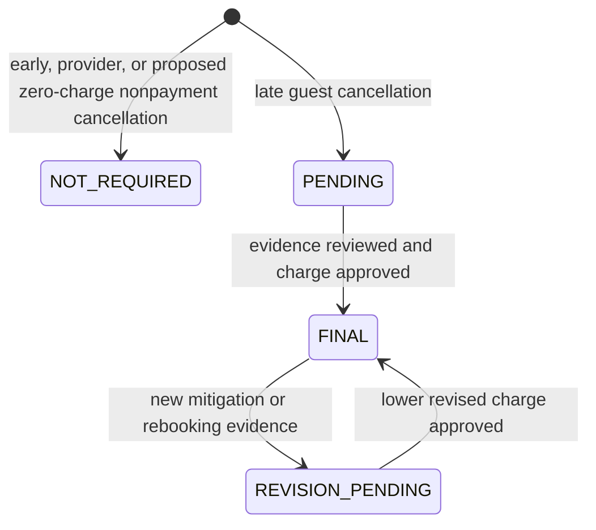
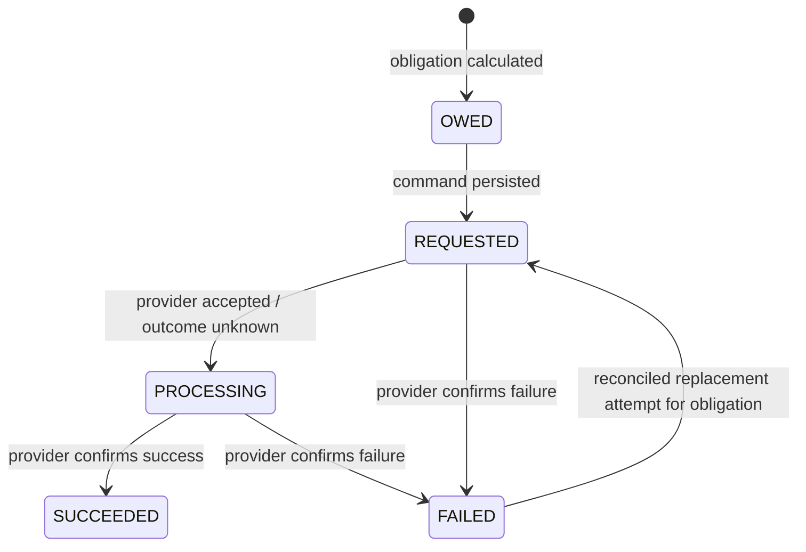
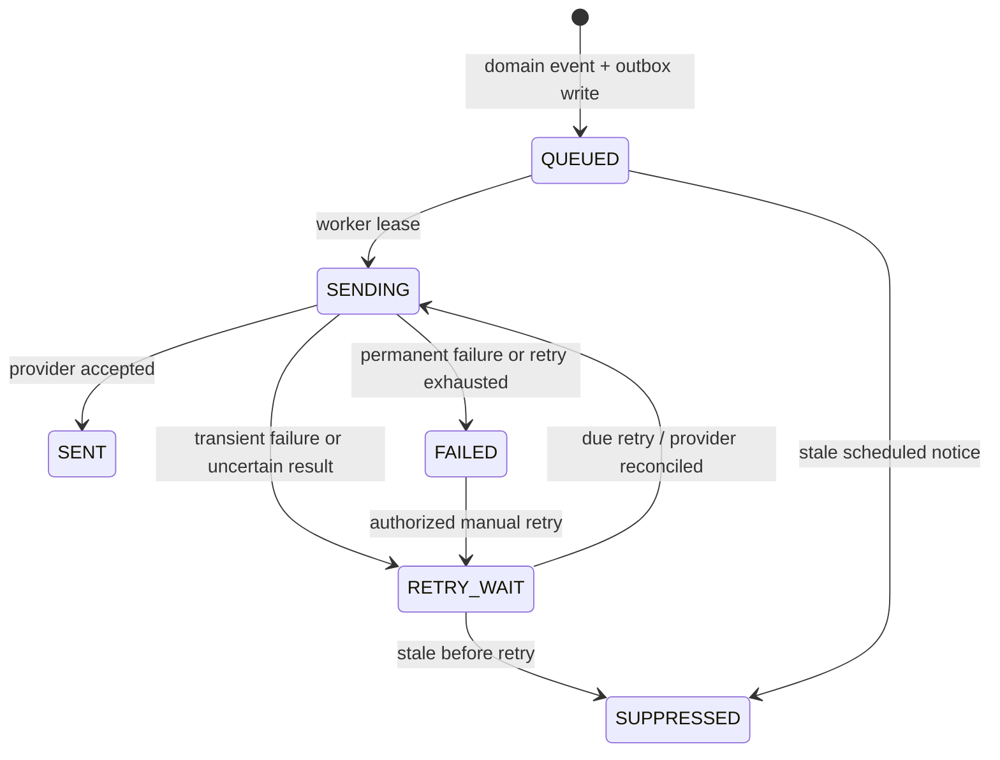

# Milestone 2 — State machines and atomic boundaries

These are domain contracts for [the booking/payment specification](BOOKING_PAYMENT_SPEC.md), not a database schema. Every transition records an immutable audit event and uses a stable operation key. `t` is a UTC instant evaluated in `Europe/Vilnius` where policy requires. `D` is arrival minus 14 calendar days at provisional local 15:00; `G = D + 24 elapsed hours`. Inventory claims share one database exclusion domain across holds, confirmed bookings and operator blocks.

## A. Inventory holds

| From → to | Trigger and preconditions | Atomic database change; side effect / recovery |
| --- | --- | --- |
| none → `CREATING` | Valid quote, accepted terms, available unit/date interval | Insert blocking claim, pending booking, attempt and create command together. Stripe creation occurs later with persistent key; conflicting transaction fails. |
| `CREATING` → `ACTIVE` | Created Session ID/creation/expiry persisted, original claim owned | Store provider times and URL once; return URL after commit. Checkout's 30 minutes start at provider creation, after claim acquisition. On timeout reconcile with the same key only before the API v1 24-hour boundary. |
| `CREATING`/`ACTIVE` → `RECONCILING` | Creation uncertain, expiry reached, abandon requested, or ambiguous payment | Keep claim blocking; enqueue provider retrieval/expiration and alert if prolonged. |
| `RECONCILING` → `ACTIVE` | Authoritative Session is open, unpaid and unexpired, no payment is processing, original claim still owned and booking pending | Persist verified Session/expiry; atomically return matching initial attempt `RECONCILING → OPEN`; return same usable URL. If any condition fails, remain blocking in `RECONCILING` or take the verified terminal/success path. |
| `ACTIVE`/`RECONCILING` → `CONSUMED` | Exact initial payment verified; claim still exclusively owned; booking eligible | Under one lock/transaction replace hold claim by booking claim, credit payment and confirm booking. Queue confirmation notice. Constraint guards race. |
| `CREATING`/`ACTIVE`/`RECONCILING` → `RELEASED` | Provider terminal unpaid/expired and no success in flight | Atomically release claim, close draft if no next attempt, audit. Retry retrieval on uncertainty, keep blocking. |

`CONSUMED` and `RELEASED` never return to blocking states. A late success after release becomes unallocatable and is refunded, never a `RELEASED → CONSUMED` shortcut. `ACTIVE → RELEASED` without provider reconciliation is forbidden. The blocking claim can predate provider Session creation and can remain beyond the Session's nominal 30-minute expiry while reconciliation is unresolved; it is not released by a timer alone. A new attempt has a new hold/attempt ID after old checkout is terminal or atomically transferred. At/after the API v1 24-hour key boundary, an uncertain creation stays `RECONCILING` for authoritative identification or operational investigation, never a blind retry.

## B. Bookings

| From → to | Trigger and preconditions | Atomic database change; side effect / recovery |
| --- | --- | --- |
| none → `AWAITING_INITIAL_PAYMENT` | Hold acquired, quote/terms snapped | Insert pending booking and hold claim. No confirmation notice. |
| `AWAITING_INITIAL_PAYMENT` → `CONFIRMED` | Verified exact initial capture and exclusive claim | Transfer claim, record credit/payment position; enqueue confirmation. Duplicate event is no-op. |
| `AWAITING_INITIAL_PAYMENT` → `EXPIRED` | All attempts terminal unpaid and hold released | Close draft. Late capture handled as unallocatable refund incident. |
| `CONFIRMED` → `CANCELLED_GUEST` | Scoped guest request, decisive instant recorded | Release booking claim; zero or pending assessment based on `t < D`; create refund obligation and notice. |
| `CONFIRMED` → `CANCELLED_NONPAYMENT` | `t >= G`, authoritative reconciliation proves balance unpaid and no uncertain attempt | Release claim; under the **proposed, commercially unapproved zero-charge default**, create a refund obligation for all verified paid amounts; enqueue notice. If uncertain, defer and reconcile. No nonpayment fee is approved. |
| `CONFIRMED` → `CANCELLED_PROVIDER` | Authorized operator, attributable reason | Release claim, create full refund obligation and notice. |
| `CONFIRMED` → `COMPLETED` | Actual stay completion rule approved later | Historical state only; inventory interval remains historical. No automatic no-show or charge. |

Only `CONFIRMED` bookings block inventory. `AWAITING_INITIAL_PAYMENT` is blocked by its **hold**, not by an independent booking claim. Canceled and expired bookings do not block; historical completed bookings are retained but not future blockers. Payment position (`INITIAL_DUE`, `BALANCE_DUE`, `OVERDUE`, `PAID_IN_FULL`, `REFUND_DUE`, `REFUNDED_PARTIAL`, `REFUNDED_FULL`, `PAYMENT_INCIDENT`) is a derived/independent ledger view and cannot substitute for booking state. A late webhook cannot transition a canceled booking back to `CONFIRMED`. Cancel-vs-payment races serialize on booking/claim locks; if payment was successful before the applicable deadline but event delayed, cancellation must await provider reconciliation. If post-release success is discovered, open incident and refund without evicting the next guest.

## C. Payment attempts and ledger

| From → to | Trigger and preconditions | Atomic database change; side effect / recovery |
| --- | --- | --- |
| none → `CREATING` | New initial/balance obligation with no other usable attempt | Insert attempt, expected EUR cents and provider-create command. External Session call uses stable Stripe key. |
| `CREATING` → `OPEN` | Session returned and persisted | Store unique Session ID, provider creation/expiry, metadata and URL. Unknown result enters `RECONCILING`, not a second create. |
| `OPEN`/`CREATING` → `RECONCILING` | Signed event, return-page query, timeout, scheduler or expiry | Store verified event ID; enqueue provider retrieval. No credit merely from `checkout.session.completed`. |
| `RECONCILING` → `OPEN` | Authoritative Session is open, unpaid and unexpired, no payment is processing, obligation unsatisfied; initial attempt also requires owned blocking claim | Persist verified provider state and reuse the same Session. For an initial attempt, atomically return its hold `RECONCILING → ACTIVE`; a balance attempt has no hold. Never create another Session for this recovery. |
| `OPEN`/`RECONCILING` → `SUCCEEDED` | Retrieved Session paid and linked PaymentIntent succeeded, exact amount/currency/environment/identity | Unique payment credit by provider PaymentIntent/charge and obligation. Initial payment may confirm booking if claim owned; balance may mark paid in full. Otherwise classify unallocatable and refund. |
| `OPEN`/`RECONCILING` → `FAILED`/`EXPIRED` | Provider terminal failure/expired unpaid | Close attempt; release initial hold only after matching hold reconciliation. Do not change confirmed booking on balance failure. |

`SUCCEEDED` is historical and never reverses to `FAILED`; a refund is its own state machine. Distinct Events can describe one object, so unique Event ID plus unique payment object/obligation credit prevent double money. Out-of-order events trigger fresh object retrieval and cannot regress state. Unexpected asynchronous status remains `RECONCILING` and blocks initial inventory release; implementation must not enable async methods without D19 resolution. Wrong amount or environment is quarantined, audited, and alerted. An unknown creation result at/after 24 hours from first API v1 submission (or with unknown age) remains `RECONCILING` until an existing Session is authoritatively identified or operations documents that no operation occurred; reusing the old key cannot prove uniqueness.

## D. Cancellation assessments

| From → to | Trigger and preconditions | Atomic database change; side effect / recovery |
| --- | --- | --- |
| none → `NOT_REQUIRED` | Early guest or provider cancellation; nonpayment only under proposed, commercially unapproved zero-charge default | Record charge zero and refund obligation equal to verified paid amount. No nonpayment fee is approved. |
| none → `PENDING` | Guest cancellation committed at/after `D` | Record cancellation instant, max cap, evidence request and hold on final refund calculation; notify guest of review. |
| `PENDING` → `FINAL` | Authorized reviewer, documented supportable net loss and mitigations | Immutable version with `0 <= charge <= floor(total×30/100)`, derive refund obligation; queue refund command and notice. |
| `FINAL` → `REVISION_PENDING` → `FINAL` | New evidence, e.g. rebooking; authorized review | Append lower charge version and incremental refund obligation. Existing confirmed refunds remain immutable. |

No automatic `PENDING → FINAL` at 30%, no automatic advance forfeiture, no charge increase after communicated final assessment without a separate approved rule, and no assessment state directly performs provider refund. An interrupted review remains pending and visible to operations.

## E. Refunds

| From → to | Trigger and preconditions | Atomic database change; side effect / recovery |
| --- | --- | --- |
| none → `OWED` | Cancellation/adjustment or unallocatable capture | Record amount, source capture allocations and obligation key; ensure no over-refund. |
| `OWED` → `REQUESTED`; `FAILED` → new `REQUESTED` attempt | Finance-authorized command or policy worker; prior provider outcome authoritatively reconciled | Persist a unique refund operation and Stripe idempotency key before API call. A confirmed failure may lead to a linked replacement attempt; an uncertain POST may be retried with its same key only before the API v1 24-hour boundary. After that, quarantine for identification/investigation. |
| `REQUESTED` → `PROCESSING` | Provider accepted or network result uncertain | Store provider refund ID if known; poll/retrieve and alert on delay. Do not claim refund complete. |
| `REQUESTED`/`PROCESSING` → `FAILED` | Authoritative failed refund | Preserve amount owed, reason and retry history; alert operations. |
| `PROCESSING` → `SUCCEEDED` | Authoritative provider success | Record unique ledger refund, reduce outstanding obligation and enqueue guest confirmation. |

`SUCCEEDED` is terminal. Duplicate provider callbacks cannot duplicate a ledger debit or notice. A refund of unknown outcome remains `PROCESSING` (quarantined, with liability outstanding), not `FAILED`. At/after 24 hours from first API v1 submission, or if its age is unknown, never blindly repeat the POST: inspect provider refund IDs/events and the charge/PaymentIntent's refund history. A missing search result alone does not prove no refund occurred. A replacement attempt needs a new ID/key linked to the same remaining obligation and an authorized, documented finding that the old operation did not succeed. If unresolved, keep it quarantined and alert operations. Refunding more than confirmed captures or more than remaining obligation is forbidden.

## F. Notifications

| From → to | Trigger and preconditions | Atomic database change; side effect / recovery |
| --- | --- | --- |
| none → `QUEUED` | Domain transition or scheduled eligibility; unique notification key | Insert outbox row in triggering transaction. |
| `QUEUED`/`RETRY_WAIT` → `SENDING` | Due worker lease; still relevant for scheduled notice | Record attempt and lease. A stale notice becomes `SUPPRESSED` with reason. |
| `QUEUED`/`RETRY_WAIT` → `SUPPRESSED` | Scheduled notice has become obsolete before dispatch or retry (for example, a balance warning at/after `D` or after payment/cancellation) | Audit suppression; do not send the obsolete notice. Never suppress a required cancellation/refund notice merely because its first delivery failed. |
| `SENDING` → `SENT` | Provider accepted message | Store provider message ID and response; delivery/bounce status can be tracked separately. No financial state change. |
| `SENDING` → `RETRY_WAIT`/`FAILED` | Timeout/transient error or permanent/exhausted error | Audit attempt; backoff or alert. Unknown send outcome reconciled before retry where provider supports it. |
| `FAILED` → `RETRY_WAIT` | Authorized manual resend | Preserve original key and history; no duplicate domain event. |

`SENT`, `SUPPRESSED` and `FAILED` do not modify booking, payment, assessment or refund status. An email failure never reverses a confirmed booking. Notification matrix and retry cadence are in the main specification.

## Cross-machine transaction and failure rules

1. **Claim acquisition:** one PostgreSQL transaction inserts pending booking, hold and attempt command under the common unit/date no-overlap constraint. Operator blocks participate in the same constraint.
2. **Initial success:** one transaction locks booking/hold/attempt, inserts unique payment credit, atomically transfers the sole claim to confirmed booking, changes states, writes audit and outbox. Constraint failure or lost claim creates an unallocatable-payment incident/refund obligation; it cannot silently confirm.
3. **Cancellation:** one transaction locks booking/payment view, records decisive time and reason, changes booking status, releases claim, creates assessment/refund obligation as applicable, and writes audit/outbox. Nonpayment adds a provider reconciliation barrier outside the transaction and a final locked recheck before commit; uncertain provider state defers it.
4. **Refund:** command persisted transactionally, Stripe call outside transaction, provider success recorded transactionally with unique refund ledger key and notice. Unknown network outcomes remain processing until authoritative identification or investigation; the API v1 24-hour key boundary ends automatic retry permission.
5. **Scheduler/webhook:** jobs use stable idempotency keys, unique inbox/outbox rows and leases. A crash before commit rolls back; a crash after commit can replay safely. Provider calls use persisted keys only while their API v1 retention window is safe; otherwise quarantine and reconcile. Global lock order should be unit claim → booking → attempt/ledger → outbox; Milestone 3 validates exact locking/isolation.

No separate payment or notification state can override inventory ownership. The database rejects overlaps even under simultaneous requests. A paid-but-unallocatable incident is money owed, not a valid reservation. Terminal states and audit history are retained for reconciliation.
