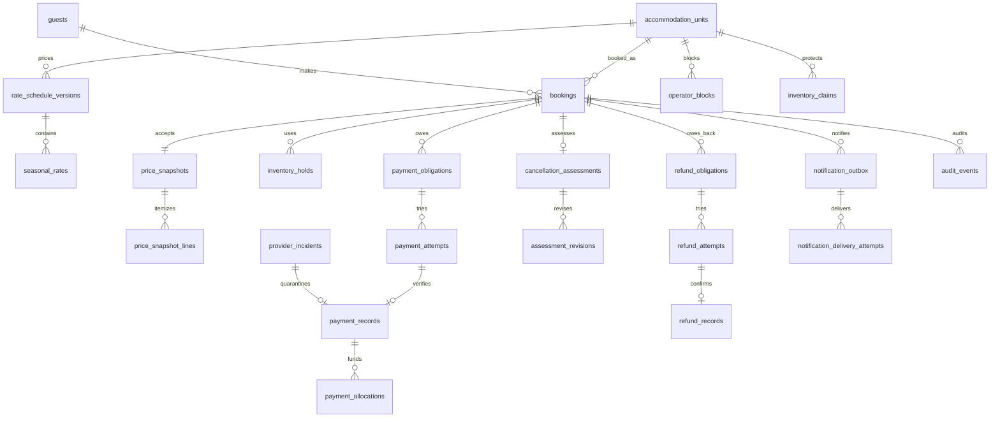

# Milestone 3 — PostgreSQL/Drizzle schema and transactional invariants

**Status:** Proposed implementation-ready database contract; documentation only. No tables, migrations, packages, application code, live payments or operational authorization have been created. Milestone 2's [domain rules](BOOKING_PAYMENT_SPEC.md), [state machines](BOOKING_STATE_MACHINES.md) and [34 acceptance scenarios](BOOKING_ACCEPTANCE_SCENARIOS.md) are authoritative. The portfolio uses fictional units and synthetic guests with Stripe **test mode** only. This proposal does not approve provisional commercial or legal decisions.

## 1. Scope, naming, and representation

Use PostgreSQL with Drizzle's PostgreSQL table definitions for ordinary columns, primary/foreign keys, checks and indexes. Keep the critical exclusion constraint, `btree_gist` extension, immutability/transition triggers and any deferred cross-table checks in reviewed explicit SQL **at the later migration milestone**; Drizzle declarations alone are not an inventory guarantee. Pin PostgreSQL/Drizzle versions before writing migrations and validate generated SQL against the selected server. This document names tables in `snake_case`, singular IDs as `id`, foreign keys as `<entity>_id`, monetary columns as `*_cents`, local stay boundaries as `*_date`, and instants as `*_at`. Default IDs are UUIDs; provider IDs are opaque `text`. Use `bigint` for EUR cents, with checked bounds and TypeScript `bigint`/decimal string serialization rather than JavaScript floating point. Use `timestamptz` for instants (stored as UTC-compatible values) and `date` for arrival/departure.

The database model separates **commercial records** (`bookings`, immutable `price_snapshots`), **inventory ownership** (`inventory_claims`), **provider operations** (`payment_attempts`, `refund_attempts`, `provider_commands`), **verified money movements** (`payment_records`, `refund_records`), **obligations and allocations**, and **delivery/audit evidence**. Status columns carry exactly the Milestone 2 state names. Payment position (`BALANCE_DUE`, `OVERDUE`, `PAID_IN_FULL`, refund due/paid) is a query/projection from obligations and verified records, not a booking status or an independently writable source of truth. `COMPLETED` remains a later-milestone booking transition, not a no-show policy.

PostgreSQL sources for this design: [range and exclusion behavior](https://www.postgresql.org/docs/current/rangetypes.html), [constraints](https://www.postgresql.org/docs/current/ddl-constraints.html), [`btree_gist`](https://www.postgresql.org/docs/current/btree-gist.html), [transaction isolation](https://www.postgresql.org/docs/current/transaction-iso.html) and [row locks](https://www.postgresql.org/docs/current/explicit-locking.html). Drizzle's [constraints](https://orm.drizzle.team/docs/indexes-constraints) and [transactions](https://orm.drizzle.team/docs/transactions) describe the ordinary mapping; explicit SQL remains necessary where the ORM does not express a database guarantee. These are design references, not migration artifacts.

## 2. Entity and relationship map



`inventory_claims` has **exactly one current owner** (`hold_id`, `booking_id`, or `operator_block_id`) while active. It keeps its own unit and half-open date range; a deferred consistency check compares these with the owner row. A successful initial payment updates one claim's owner from hold to booking inside the same transaction. The original hold remains as history in `inventory_holds` and `audit_events`; its ID is also retained as `origin_hold_id` on the claim. Releasing a claim sets `released_at`, never deletes it. A new checkout uses a new claim after the prior attempt is terminal; historical claims do not block.

## 3. Proposed relational tables

Unless noted, `id uuid PRIMARY KEY`, `created_at timestamptz NOT NULL`, and relevant `updated_at timestamptz NOT NULL` are common. All foreign keys use `ON DELETE RESTRICT` for booking/financial/audit history; do not cascade-delete commercial records. Required columns are `NOT NULL`; optional columns are marked `?`. The tables below specify primary business columns; normal bookkeeping timestamps apply throughout.

### Accommodation and immutable price evidence

| Table (grain) | Columns and PostgreSQL types | Relationships, constraints and indexes |
| --- | --- | --- |
| `accommodation_units` (one fictional cottage) | `id uuid`, `unit_key text`, `capacity smallint`, `enabled boolean`, `config_version integer` | `UNIQUE(unit_key)`; `CHECK(capacity > 0, config_version > 0)`; no physical address field. Disable rather than delete. |
| `rate_schedule_versions` (one unit tariff version) | `id uuid`, `unit_id uuid`, `version_no integer`, `state text` (`DRAFT/ACTIVE/RETIRED`), `activated_at timestamptz?` | FK unit; `UNIQUE(unit_id,version_no)`; at most one `ACTIVE` version per unit by partial unique index. Activated versions and their lines are immutable. Actual tariff values remain Milestone 6 data. |
| `seasonal_rates` (one date band and day class within version) | `id uuid`, `rate_schedule_version_id uuid`, `start_date date`, `end_date date`, `day_class text` (`WEEKDAY/WEEKEND`), `nightly_cents bigint`, `currency char(3)` | FK version; `CHECK(start_date < end_date, nightly_cents >= 0, currency='EUR')`; GiST exclusion on `(rate_schedule_version_id =, day_class =, daterange(start_date,end_date,'[)') &&)` prevents conflicting bands within one version/class. Gaps and actual weekend classification require price-engine validation, not invented rates. |
| `price_snapshots` (one accepted quote per booking) | `id uuid`, `booking_id uuid`, `rate_schedule_version_id uuid?`, `accepted_at timestamptz`, `terms_version text`, `policy_version text`, `locale text`, `currency char(3)`, `total_cents bigint`, `initial_cents bigint`, `balance_cents bigint`, `split_basis text` (`ADVANCE/FULL`), `quote_operation_key text` | `UNIQUE(booking_id)`, `UNIQUE(quote_operation_key)`; FKs booking/version; checks for `EUR`, `lt/en/de`, nonnegative cents, `initial+balance=total`, and `FULL ⇒ balance=0`. A deferred check or trigger validates `ADVANCE ⇒ initial=floor((total*30+50)/100)` and `balance=total-initial`, based on immutable booking acceptance time versus `D`. Snapshot is append-only after acceptance. |
| `price_snapshot_lines` (one itemized accepted amount) | `id uuid`, `snapshot_id uuid`, `line_no integer`, `kind text` (`NIGHT/EXTRA/FEE/TAX/DISCOUNT`), `description_key text`, `quantity integer`, `unit_cents bigint`, `amount_cents bigint`, `details jsonb?` | FK snapshot; `UNIQUE(snapshot_id,line_no)`; quantity positive, signed discounts only in `DISCOUNT`, `amount_cents=quantity*unit_cents` with overflow-safe arithmetic. Deferred aggregate check: line amounts sum to snapshot total. Do not infer unresolved fees/taxes. |

Use a new schedule version rather than editing a version referenced by a snapshot. A snapshot records accepted totals even if future reference rates change. The price engine later determines valid lines and quote expiry; this milestone defines their storage and consistency, not rate data or a tariff formula beyond the approved split. Do not store percentages as floating point.

### Guests, bookings, and inventory ownership

| Table (grain) | Columns and PostgreSQL types | Relationships, constraints and indexes |
| --- | --- | --- |
| `guests` (one synthetic guest identity) | `id uuid`, `email_ciphertext bytea`, `email_lookup_digest bytea?`, `name_ciphertext bytea?`, `preferred_locale text`, `retention_state text` | Check locale `lt/en/de`; index digest only if keyed/HMAC lookup is needed, not plain email. Encryption keys stay outside database/source control. No card data. |
| `bookings` (one reservation/draft) | `id uuid`, `guest_id uuid`, `unit_id uuid`, `arrival_date date`, `departure_date date`, `guest_count smallint`, `status text`, `version integer`, `accepted_at timestamptz`, `check_in_local_time time`, `property_zone text`, `scheduled_arrival_at timestamptz`, `warning_at timestamptz`, `balance_due_at timestamptz`, `grace_ends_at timestamptz`, `cancelled_at timestamptz?`, `cancellation_reason text?` | FKs guest/unit; `CHECK(arrival_date<departure_date, guest_count>0, property_zone='Europe/Vilnius', version>0)` and state enum/check; indexes `(unit_id,arrival_date,departure_date)`, `(status,balance_due_at)`, `(status,grace_ends_at)`, `(guest_id,created_at)`. Deferred owner/snapshot checks; guest count versus unit capacity requires locked transactional check or deferred trigger. Accepted dates/price/time policy fields are immutable; date changes are outside initial scope. |
| `guest_access_tokens` (one scoped manage-booking credential) | `id uuid`, `booking_id uuid`, `token_hash bytea`, `scope text`, `expires_at timestamptz`, `revoked_at timestamptz?`, `last_used_at timestamptz?` | FK booking; `UNIQUE(token_hash)`; index `(booking_id,expires_at)`; only hash stored, no raw token. Authorization checks booking and scope on each request. |
| `inventory_holds` (one initial checkout hold attempt) | `id uuid`, `booking_id uuid`, `payment_attempt_id uuid?`, `state text` (`CREATING/ACTIVE/RECONCILING/CONSUMED/RELEASED`), `started_at timestamptz`, `terminal_at timestamptz?`, `version integer` | FKs booking and optional initial attempt; partial unique `(booking_id)` while state is `CREATING/ACTIVE/RECONCILING`; index `(state,started_at)`. Booking/attempt identity consistency via deferred check. No clock-only expiry release. |
| `operator_blocks` (one authorized unit/date block) | `id uuid`, `unit_id uuid`, `arrival_date date`, `departure_date date`, `reason_code text`, `created_by_admin_id uuid`, `released_at timestamptz?` | FKs unit/admin; `CHECK(arrival_date<departure_date)`; unique active claim owner; release requires authorized, audited command. Same exclusion domain as guests. |
| `inventory_claims` (one historical or currently blocking claim) | `id uuid`, `unit_id uuid`, `arrival_date date`, `departure_date date`, `stay daterange` generated as `[arrival,departure)`, `hold_id uuid?`, `booking_id uuid?`, `operator_block_id uuid?`, `origin_hold_id uuid?`, `released_at timestamptz?`, `release_reason text?`, `version integer` | FKs unit/hold/booking/block/origin hold; `CHECK(arrival_date<departure_date, num_nonnulls(hold_id,booking_id,operator_block_id)=1)`; `UNIQUE(hold_id)`, `UNIQUE(booking_id)`, `UNIQUE(operator_block_id)`, `UNIQUE(origin_hold_id)` for non-null values. Partial GiST exclusion on `(unit_id =, stay &&)` where `released_at IS NULL`; deferred owner/date/state validation. Index `(unit_id,released_at)` for occupancy scans. |
| `admin_users` (one administrator identity) | `id uuid`, `external_subject text`, `role text`, `enabled boolean`, `disabled_at timestamptz?` | `UNIQUE(external_subject)`; role is a controlled value (operations/finance/administrator); external authentication and role checking are required before commands, not granted by this row alone. |

The booking row is inserted before its snapshot/hold/claim in one transaction. A deferred final-state check ensures a pending booking has one active hold-owned claim, a confirmed booking has one active booking-owned claim, and cancelled/expired/completed bookings have none. `inventory_holds` can have several historical attempts for one booking, but only one active hold; a booking-owned claim may preserve `origin_hold_id` without remaining hold-owned. For `operator_blocks`, the claim owns the same unit and dates as the block. These conditions need constraint triggers or tightly controlled stored transaction functions because a row-local `CHECK` cannot read another table. Do not substitute separate exclusion constraints on holds, bookings and blocks.

### Obligations, attempts, verified captures, and allocation

| Table (grain) | Columns and PostgreSQL types | Relationships, constraints and indexes |
| --- | --- | --- |
| `payment_obligations` (one `INITIAL` or `BALANCE` amount per booking) | `id uuid`, `booking_id uuid`, `kind text`, `amount_cents bigint`, `due_at timestamptz`, `currency char(3)` | FK booking; `UNIQUE(booking_id,kind)`; check kind and EUR/nonnegative cents. Always create both rows: for full initial payment the balance row is zero and schedules no reminder. Deferred check: initial+balance equals snapshot total and each matches its snapshot amount; `BALANCE.due_at=bookings.balance_due_at`. |
| `payment_attempts` (one Checkout Session attempt for one obligation) | `id uuid`, `booking_id uuid`, `obligation_id uuid`, `hold_id uuid?`, `state text` (`CREATING/OPEN/RECONCILING/SUCCEEDED/FAILED/EXPIRED`), `expected_cents bigint`, `currency char(3)`, `stripe_session_id text?`, `stripe_payment_intent_id text?`, `session_created_at timestamptz?`, `session_expires_at timestamptz?`, `last_reconciliation_id uuid?`, `version integer` | FKs booking/obligation/hold; `UNIQUE(stripe_session_id)`, `UNIQUE(stripe_payment_intent_id)` when non-null; partial unique `(obligation_id)` for `CREATING/OPEN/RECONCILING`; check positive expected cents/EUR and `session_expires_at>session_created_at` when both known. Composite identity check: obligation belongs to same booking; `hold_id` only for `INITIAL`. A locked transactional check requires `expected_cents` to equal the obligation's unpaid amount when created. Index `(state,session_expires_at)`. |
| `payment_records` (one verified captured provider payment) | `id uuid`, `attempt_id uuid?`, `booking_id uuid?`, `obligation_id uuid?`, `provider_incident_id uuid?`, `stripe_payment_intent_id text`, `stripe_charge_id text?`, `captured_cents bigint`, `currency char(3)`, `provider_succeeded_at timestamptz?`, `verified_at timestamptz`, `allocation_state text` (`ALLOCATED/UNALLOCATABLE`), `refund_encumbered_cents bigint DEFAULT 0`, `reconciliation_id uuid` | FKs attempt/booking/obligation/incident/reconciliation; `UNIQUE(attempt_id)`, `UNIQUE(provider_incident_id)`, `UNIQUE(stripe_payment_intent_id)`, unique non-null charge. Check either `(attempt_id,booking_id,obligation_id)` are present and incident absent, **or** incident alone is present with `UNALLOCATABLE`; EUR, positive capture and `0<=refund_encumbered_cents<=captured_cents`. Composite FK/trigger prevents mismatched known booking/obligation. Verified success time may remain unknown, deferring automatic nonpayment cancellation. Capture identity/amount are immutable; only refund reservation and controlled allocation state change. |
| `payment_allocations` (one capture-to-obligation credit) | `id uuid`, `payment_record_id uuid`, `obligation_id uuid`, `amount_cents bigint` | FKs payment/obligation; `UNIQUE(payment_record_id,obligation_id)`; check positive amount. A database trigger locks both budget parents in the fixed order below for every insert/update/delete; deferred constraint triggers then check total allocations ≤ capture and ≤ obligation and same booking. An `UNALLOCATABLE` capture has no allocation and creates a refund obligation. |

The balance is **not** a mutable booking field: `balance_remaining = BALANCE.amount_cents − SUM(verified allocations to BALANCE)`. Initial and balance obligations sum to `total_cents`; `advance=floor((total_cents*30+50)/100)` and `balance=total−advance` when accepted before `D`, otherwise initial=total and balance=0. Arithmetic must be evaluated with a wide integer/numeric intermediate before checked `bigint` storage to avoid overflow. Payment credits require verified provider Session `paid` **and** PaymentIntent `succeeded`, matching amount/currency/test environment/metadata. Provider truth and signature verification are application responsibilities; PostgreSQL guarantees uniqueness and committed row relationships, not that Stripe actually received funds. Unallocatable payments, including a verified capture with **no safely identifiable internal attempt**, remain visible and refundable without confirming a booking. Such a capture is tied to `provider_incidents` until investigated; it cannot be allocated to a guessed booking.

At `READ COMMITTED`, a deferred aggregate query alone permits write skew. All allocation writers, including direct SQL and updates that move or resize an allocation, must pass a database-enforced serialization point: a trigger locks the affected `payment_obligations` parent row(s) and then `payment_records` parent row(s), sorting IDs within each class; an update locks old and new parents. The deferred constraint trigger re-reads committed allocation sums after those locks and rejects an over-budget or cross-booking result at commit. Application transaction routines take the same locks before calculating a remaining balance, but that discipline is not the database guarantee. Adversarial implementation test: two distinct €100 captures and one €100 obligation start unallocated; two `READ COMMITTED` transactions each try to allocate €60 from a different capture to that obligation. Each would see its own €60 as affordable without serialization. The second must wait for the first obligation lock, then its aggregate check must see €120 and reject/roll back; the committed allocation total must remain €60. Repeat with one capture and two different obligations to exercise the capture budget.

### Cancellation, refund and immutable adjustments

| Table (grain) | Columns and PostgreSQL types | Relationships, constraints and indexes |
| --- | --- | --- |
| `cancellation_assessments` (one cancellation decision process per booking) | `id uuid`, `booking_id uuid`, `state text` (`NOT_REQUIRED/PENDING/FINAL/REVISION_PENDING`), `cancelled_at timestamptz`, `reason text` (`GUEST_EARLY/GUEST_LATE/NONPAYMENT/PROVIDER`), `cap_cents bigint`, `current_revision_no integer?` | FK booking; `UNIQUE(booking_id)`; check nonnegative cap, state/reason combinations; deferred check ties cancellation to booking and cap to `floor(total*30/100)` for late guest cancellation. `NOT_REQUIRED` charge zero for early/provider and only under the **proposed, commercially unapproved zero-charge nonpayment default**. |
| `assessment_revisions` (one immutable evidence-backed version) | `id uuid`, `assessment_id uuid`, `revision_no integer`, `charge_cents bigint`, `supportable_loss_cents bigint`, `avoided_costs_cents bigint?`, `recovered_revenue_cents bigint?`, `replacement_booking_id uuid?`, `evidence_ref text?`, `rationale text`, `reviewed_by_admin_id uuid`, `approved_at timestamptz` | FKs assessment/replacement booking/admin; `UNIQUE(assessment_id,revision_no)`; check all amounts nonnegative, `charge<=cap` and `charge<=supportable_loss` via deferred cross-row check; later finalized revisions may only reduce a communicated charge unless separately approved policy. Do not put raw guest documents or PII in evidence fields; use a controlled evidence reference. |
| `refund_obligations` (one amount owed for cancellation, revision or unallocatable payment) | `id uuid`, `booking_id uuid?`, `provider_incident_id uuid?`, `source_payment_record_id uuid?`, `assessment_revision_id uuid?`, `reason text`, `amount_cents bigint`, `refund_encumbered_cents bigint DEFAULT 0`, `business_key text`, `currency char(3)` | FKs booking/incident/source/revision; exactly one of booking or incident; an incident obligation requires its captured `source_payment_record_id`. `UNIQUE(business_key)` and unique non-null `assessment_revision_id`; checks EUR, positive amount, `0<=refund_encumbered_cents<=amount_cents`. Use a stable assessment/revision business key for each incremental liability. Count confirmed refunds and every existing outstanding obligation, including reserved/in-flight and not-yet-submitted amounts, before creating a new obligation; no automatic post-cancellation collection. |
| `refund_attempts` (one provider refund POST against one capture) | `id uuid`, `obligation_id uuid`, `payment_record_id uuid`, `state text` (`REQUESTED/PROCESSING/SUCCEEDED/FAILED`), `requested_cents bigint`, `stripe_refund_id text?`, `reconciliation_id uuid?`, `version integer` | FKs obligation/payment/reconciliation; unique non-null `stripe_refund_id`; one in-flight attempt per obligation by partial unique index on `REQUESTED/PROCESSING` (sequential partial refunds); checks positive amount. A deferred identity check requires the source capture to belong to the same booking/incident as the obligation and to match its specified `source_payment_record_id` when present. A confirmed failure permits a **new linked attempt** after reconciliation. Unknown outcome stays `PROCESSING`, including after the API v1 24-hour key boundary. |
| `refund_records` (one provider-confirmed refund movement) | `id uuid`, `refund_attempt_id uuid`, `payment_record_id uuid`, `booking_id uuid?`, `provider_incident_id uuid?`, `stripe_refund_id text`, `refunded_cents bigint`, `currency char(3)`, `provider_succeeded_at timestamptz?`, `verified_at timestamptz`, `reconciliation_id uuid` | FKs attempt/payment/booking/incident/reconciliation; exactly one of booking or incident, matching its obligation; `UNIQUE(refund_attempt_id)`, `UNIQUE(stripe_refund_id)`; checks EUR/positive cents. Append-only; only provider-confirmed success yields this row and a guest notice **when a guest is known**; otherwise alert operations. |

`refund_encumbered_cents` on both the payment record and refund obligation means **confirmed refunds plus still-pending reserved refund requests**. Requesting a refund locks both rows and atomically reserves the amount only if both counters remain within bounds. A confirmed failure releases both reservations in the same transaction; a success leaves them encumbered and inserts exactly one immutable `refund_records` row. An unknown result keeps the reservation, preventing a duplicate refund. A reconciliation query compares encumbered totals with successful plus in-flight attempts and raises an incident on drift. Charge assessments do not change provider money; an assessment revision creates a separate incremental refund obligation and audit trail. No advance forfeiture or automatic no-show charge is represented.

For an approved cancellation assessment, compute `target_refund_cents = max(0, verified_captured_cents − latest_approved_charge_cents)`. Count `confirmed_refund_cents` once from verified refund records, then count the unpaid residual of **every** existing refund obligation for that booking, whether it has an in-flight reservation, has not yet been sent to Stripe, or remains owed after a confirmed failed attempt. The residual is obligation amount less confirmed refunds attributed to it; in-flight reservations are part of that residual and must not be subtracted twice. Create only `max(0, target_refund_cents − confirmed_refund_cents − outstanding_obligation_residual_cents)` as the new liability. For €120 verified paid, an approved €50 charge creates a €70 obligation. If a new approved charge is €20 before that refund is submitted, the target is €100; the unsent €70 still counts, so the new obligation is €30 and total liability is €100. Lock booking, assessment and refund-budget rows in the documented order, append the immutable numbered revision and its uniquely keyed obligation in one transaction, and re-read the latest approved revision after the lock. Concurrent revisions serialize on the assessment row; a stale revision number fails its unique key/version check and must recompute rather than creating another liability. If verified capture or refund state is uncertain, defer the increment for reconciliation.

### Provider commands, reconciliation, notices, and audit

| Table (grain) | Columns and PostgreSQL types | Relationships, constraints and indexes |
| --- | --- | --- |
| `provider_incidents` (one unmatched or anomalous provider object) | `id uuid`, `kind text` (`UNMATCHED_PAYMENT/UNALLOCATABLE_PAYMENT/PROVIDER_MISMATCH`), `stripe_payment_intent_id text?`, `stripe_session_id text?`, `source_webhook_event_id uuid?`, `observed_cents bigint?`, `currency char(3)?`, `state text` (`OPEN/INVESTIGATING/RESOLVED`), `opened_at timestamptz`, `resolved_at timestamptz?`, `resolution_code text?` | FK source event; unique non-null PaymentIntent for unmatched capture, index `(state,opened_at)`; no guest identity inferred from provider metadata alone. An unmatched verified capture gets a unique incident-owned `payment_records` row and an operations alert; investigation may identify an attempt or arrange a provider refund without fabricating a booking. |
| `provider_commands` (one durable external POST intent) | `id uuid`, `kind text` (`SESSION_CREATE/SESSION_EXPIRE/REFUND_CREATE`), `payment_attempt_id uuid?`, `refund_attempt_id uuid?`, `logical_key text`, `stripe_idempotency_key text`, `request_fingerprint bytea`, `first_submitted_at timestamptz?`, `provider_request_id text?`, `state text` (`PENDING/SUBMITTED/UNKNOWN/QUARANTINED/RESOLVED`), `lease_owner text?`, `lease_expires_at timestamptz?`, `lease_generation bigint DEFAULT 0`, `attempt_count integer DEFAULT 0`, `last_attempt_at timestamptz?`, `next_attempt_at timestamptz?`, `last_error_code text?`, `resolved_at timestamptz?` | FKs attempt/refund; exactly one target by `CHECK(num_nonnulls(...)=1)` and kind compatibility; `UNIQUE(logical_key)`, `UNIQUE(stripe_idempotency_key)`; owner/expiry are both null or both set; nonnegative generation/count; indexes `(state,next_attempt_at,lease_expires_at)` and `(state,first_submitted_at)`. Keep minimal non-PII parameters/fingerprint. Lease expiry permits recovery work, never an inference that a Stripe POST failed or permission to bypass API v1 key quarantine. |
| `stripe_webhook_events` (one verified Stripe Event ID) | `id uuid`, `stripe_event_id text`, `event_type text`, `object_type text`, `object_id text`, `provider_created_at timestamptz`, `received_at timestamptz`, `payload_digest bytea`, `processing_state text`, `processed_at timestamptz?`, `delivery_count integer` | `UNIQUE(stripe_event_id)`; index `(processing_state,received_at)`, `(object_type,object_id)`; only insert after raw-body signature and test-environment verification. Keep minimal metadata and digest, not whole payment/card payload by default. Duplicate deliveries increment/log without repeating domain effects. |
| `reconciliation_records` (one observed provider state/evidence) | `id uuid`, `payment_attempt_id uuid?`, `refund_attempt_id uuid?`, `provider_incident_id uuid?`, `webhook_event_id uuid?`, `checked_at timestamptz`, `provider_object_id text?`, `provider_state text`, `payment_status text?`, `amount_cents bigint?`, `currency char(3)?`, `provider_success_at timestamptz?`, `evidence_kind text`, `result text`, `evidence_ref text?` | Exactly one of attempt/refund/incident subject FKs; optional event FK; indexes `(payment_attempt_id,checked_at DESC)`, `(refund_attempt_id,checked_at DESC)`, `(provider_incident_id,checked_at DESC)`. Append-only. Authoritative success-time evidence is needed for nonpayment cancellation; absent reliable timing, defer. An observation is not itself a credit. |
| `notification_outbox` (one logical message/recipient) | `id uuid`, `booking_id uuid?`, `provider_incident_id uuid?`, `source_audit_event_id uuid`, `event_type text`, `recipient_kind text`, `recipient_ref uuid?`, `locale text`, `idempotency_key text`, `due_at timestamptz`, `state text` (`QUEUED/SENDING/RETRY_WAIT/SENT/FAILED/SUPPRESSED`), `lease_until timestamptz?`, `suppression_reason text?`, `provider_message_id text?` | FKs booking/incident/audit; exactly one of booking or incident; incident-only messages target operations until guest identity is verified. `UNIQUE(idempotency_key)`, unique non-null provider message ID; indexes `(state,due_at)`, `(state,lease_until)`. Locale check `lt/en/de`; no plaintext guest email in outbox. Suppress obsolete balance warnings at/after `D`, including retry wait; do not suppress required cancellation/refund notices. |
| `notification_delivery_attempts` (one transport attempt) | `id uuid`, `notification_id uuid`, `attempt_no integer`, `started_at timestamptz`, `finished_at timestamptz?`, `result text`, `provider_message_id text?`, `error_code text?` | FK outbox; `UNIQUE(notification_id,attempt_no)` and unique non-null provider message ID where provider semantics permit; index `(notification_id,started_at)`; record timeout as uncertain, not delivered. |
| `audit_events` (one immutable domain/authorization event) | `id uuid`, `booking_id uuid?`, `unit_id uuid?`, `actor_kind text`, `admin_user_id uuid?`, `guest_id uuid?`, `service_name text?`, `action text`, `entity_type text`, `entity_id uuid?`, `prior_state text?`, `new_state text?`, `amount_cents bigint?`, `operation_key text?`, `reason_code text?`, `occurred_at timestamptz`, `details jsonb?` | FKs where typed; actor-kind checks; indexes `(booking_id,occurred_at)`, `(entity_type,entity_id,occurred_at)`, `(operation_key)`. Append-only and redacted; no raw email, token, card or webhook body. Denied admin/guest access is audited without revealing another guest's booking. |

`notification_outbox.source_audit_event_id` and `audit_events.booking_id` are not circular requirements: write the audit row first, then outbox row in the same transaction. Booking notices use Milestone 2's booking-based key; incident-only operations alerts use a distinct `incident-id:event-type:domain-event-id:recipient:locale` key. A provider notification acceptance does **not** modify any financial state. Guest manage tokens, administrator identities, and service credentials have distinct scopes; database roles should grant the Next.js application/worker only the minimum tables or controlled routines needed, and migrations should use a separate privileged role. Authorization decisions remain in the application/service layer with an audit record; neither knowledge of a booking ID nor direct database read should grant guest access.

## 4. PostgreSQL inventory constraint and direct guarantees

The decisive invariant is **one active claim per overlapping unit/date interval, regardless of owner kind**. The illustrative DDL below is a design sketch, not a migration to run now. `btree_gist` supplies equality for UUID unit IDs and GiST handles the range overlap. PostgreSQL's exclusion constraint creates its own index. The generated range uses inclusive arrival and exclusive departure; `[April 1, April 3)` and `[April 3, April 5)` do not overlap.

```sql
-- Illustrative only; implement and validate in a later migration milestone.
CREATE EXTENSION IF NOT EXISTS btree_gist;
-- In inventory_claims: stay daterange GENERATED ALWAYS AS
--   (daterange(arrival_date, departure_date, '[)')) STORED;
-- In inventory_claims: CHECK (arrival_date < departure_date);
-- In inventory_claims: CHECK (num_nonnulls(hold_id,booking_id,operator_block_id)=1);
ALTER TABLE inventory_claims
  ADD CONSTRAINT inventory_claims_no_overlap
  EXCLUDE USING gist (unit_id WITH =, stay WITH &&)
  WHERE (released_at IS NULL)
  DEFERRABLE INITIALLY IMMEDIATE;
```

The active predicate is **only** `released_at IS NULL`; it does not depend on `expires_at`, current time, hold state or booking state. Therefore an unresolved or nominally expired hold still blocks inventory. Claim release requires a verified terminal-unpaid state or a booked cancellation/provider transition; it sets `released_at` atomically with the status/audit changes. No worker can make dates free merely by passing a 30-minute timer. Two concurrent claim inserts, including a guest hold versus an operator block, cannot both commit when dates overlap. Treat exclusion violation SQLSTATE `23P01` as unavailable/conflict; do not call Stripe for the loser. The same constraint protects confirmation even if an application availability query races. A separate non-overlap exclusion for `seasonal_rates` concerns pricing configuration and has no inventory authority.

Row-local `CHECK`, `NOT NULL`, `UNIQUE`, FK and exclusion constraints are direct PostgreSQL guarantees. The owner/status relationship, snapshot-line sum, obligation/allocation sums, assessment cap against the snapshot, and provider evidence conditions span rows or systems. PostgreSQL `CHECK` cannot safely reference other rows; use deferred constraint triggers for cross-table **committed-state** checks where practical, plus role-limited transactional routines and reconciliation reports. A trigger requiring a stored `reconciliation_records` FK can prove evidence was recorded, not that a provider response is genuine. The later implementation must test triggers with direct SQL writes and concurrent transactions; do not label an application check as database enforcement.

### State-transition guard

For `inventory_holds`, `bookings`, `payment_attempts`, `cancellation_assessments`, `refund_attempts`, and `notification_outbox`, a `BEFORE UPDATE` trigger should reject every `(OLD.state,NEW.state)` or `(OLD.status,NEW.status)` pair absent from [Milestone 2's transition tables](BOOKING_STATE_MACHINES.md). In particular, allow `RECONCILING→ACTIVE` and `RECONCILING→OPEN` only with matching authoritative open/unpaid/unexpired evidence; terminal states never regress; a released claim is never reactivated. Use a deferred constraint trigger to inspect the *final transaction state* for linked claim/booking/hold/attempt consistency. Require controlled service roles to supply a unique operation key, actor and evidence reference on sensitive transitions. Database guardrails enforce transition shape and local evidence linkage; application logic verifies the Stripe signature, current provider state, actor authority, timing and policy. Prefer explicit constraint/trigger names and versioned migration review at Milestone 5; do not execute DDL in this milestone.

## 5. Transaction protocols, isolation and recovery

Use short Drizzle transactions at PostgreSQL `READ COMMITTED` for the core paths, with explicit row locks and the exclusion/unique constraints as the final arbiter. `READ COMMITTED` alone is **not** a no-overlap guarantee. For any mutation touching inventory, establish this global order: **unit row → booking row → claim/hold row → payment obligation/attempt/record → refund reservation → audit/outbox**. Read immutable IDs to discover the unit before locking; acquire multiple unit IDs in sorted order. Administrative blocks follow the same order. A transaction that only handles money locks booking then relevant obligation/payment/refund rows. Use `SELECT ... FOR UPDATE` or conditional `UPDATE ... RETURNING` for mutable budgets and versions. Keep Stripe/email calls outside database transactions. A `23P01` exclusion failure is a business availability conflict; `23505` may be a replay or conflicting operation and must be inspected by key; `40P01` deadlock and, if `SERIALIZABLE` is chosen for a complex later workflow, `40001` require bounded retry of the **database transaction only** using the same business operation identity. Never repeat an external POST merely because a local transaction retried.

| Operation | Durable steps and commit boundary | Failure/recovery rule |
| --- | --- | --- |
| Acquire initial hold and accepted quote | Validate quote/guest/capacity/terms; begin transaction; lock unit; insert guest/booking, price snapshot+lines, two obligations, `CREATING` hold, active hold-owned claim, initial `CREATING` attempt and `provider_commands` row; deferred checks pass at commit. `accepted_at` is this durable acceptance/claim-acquisition instant, not later Session creation. | Exclusion loser rolls back everything and receives unavailable; no Stripe call. Same quote/command key returns existing draft. Crash before commit leaves no claim or command. |
| Create Checkout Session | Worker atomically claims a persisted `SESSION_CREATE` command lease, durably records first submission and parameters before its Stripe POST, then stores Session ID and provider creation/expiry in a new transaction; hold `CREATING→ACTIVE`, attempt `CREATING→OPEN`. | Timeout/commit ambiguity goes `RECONCILING`; identify provider object. Retry same key only before the safe API v1 24-hour boundary and after checking the exact operation state; after/unknown age quarantine. No second usable attempt or URL before persistence. The 30-minute Session clock starts at provider creation, not claim start. |
| Recover open Session | Retrieve Session and linked intent outside transaction; if verified open/unpaid/unexpired and no processing payment, lock unit→booking→hold/claim→attempt; check claim still owned and obligation open; attach evidence; atomically set hold `RECONCILING→ACTIVE` and attempt `RECONCILING→OPEN`. For a balance attempt, update only attempt. | If dates/ownership or provider conditions differ, remain reconciling or take terminal/success path. Never extend provider expiry or issue a new Session as part of recovery. |
| Verify initial capture and confirm | Verified provider evidence is recorded; lock unit→booking→hold/claim→attempt/obligations. Insert `payment_records` by unique PaymentIntent/attempt, allocate exact initial amount, update sole claim owner from `hold_id` to `booking_id` **without changing dates/unit**, mark hold `CONSUMED`, attempt `SUCCEEDED`, booking `CONFIRMED`, write audit and notification outbox; commit once. | If claim/booking is no longer eligible, still record unique verified capture as `UNALLOCATABLE`, create full refund obligation and incident; do not reacquire dates or change another booking. Duplicate webhook finds existing credit and has no second effect. Crash before commit replays safely; crash after commit finds unique keys. |
| Quarantine verified unmatched capture | If a valid test-mode provider payment has no safely identifiable internal attempt, insert unique `provider_incidents`, incident-owned `payment_records`, reconciliation evidence and operations outbox in one transaction, keyed by PaymentIntent. Do **not** create a guessed booking or allocation. | Investigate provider IDs/events and any unknown create command. If linkage is proved, resolve under an audited correction; otherwise create an incident-linked full refund obligation against the captured payment and use the normal refund reservation flow. This prevents provider money from existing only in logs. |
| Verify balance capture | Lock booking→balance obligation→attempt; insert unique capture/allocation, mark attempt `SUCCEEDED`, derive paid-in-full and insert audit/outbox. Booking claim remains untouched. | Late/out-of-order events reconcile current provider objects. A capture after cancellation is unallocatable and refunded. |
| Expire/abandon hold | Outside transaction, expire an open provider Session where possible and retrieve Session/PaymentIntent until terminal unpaid/expired with no success in flight. Then lock unit→booking→hold/claim/attempt and atomically release claim, set hold `RELEASED`, attempt `EXPIRED`/`FAILED`, booking `EXPIRED` if no valid replacement, audit. | If provider still open unpaid and unexpired, recover `ACTIVE/OPEN`; if processing/unknown, keep `RECONCILING` and claim active, alert. No release merely at 30 minutes. |
| Guest/provider cancellation | Verify guest token or admin authority; lock unit→booking→claim→payment view; record server decisive instant and reason; mark booking cancelled, release claim, create `NOT_REQUIRED` or `PENDING` assessment/refund obligation as applicable, audit/outbox; commit. | Guest before `D` and provider-attributable cancellation create full-paid-amount refund obligations; late guest cancellation waits for evidence-backed assessment. No automatic advance forfeiture. |
| Nonpayment cancellation | At/after `G`, reconcile **all** balance attempts outside transaction, expire open provider Session where possible, and require authoritative terminal-unpaid evidence and reliable success-time assessment. Lock unit→booking→claim→obligation/attempts; recheck no verified timely or grace-period capture and no unresolved attempt; then cancel/release/audit/outbox atomically. | If any attempt is processing/unknown or provider success time cannot be proved, defer and alert. Late webhook arrival cannot be the reason to cancel a timely payer. If a success emerges after release despite the barrier, open an incident and refund unallocatable money without evicting a new claimant. The full-refund/zero-charge nonpayment behavior is a **proposed commercial default awaiting approval**. |
| Finalize/revise assessment | Lock booking→assessment→payment/refund budget; re-read the latest approved revision and verified capture/refund totals; append approved evidence revision, check cap and supportable loss, and create only the increment beyond confirmed refunds plus **all** outstanding obligation residuals, including in-flight and unsent amounts; audit/outbox. | Rebooking may reduce charge through a new revision; never overwrite an earlier revision or silently collect after cancellation. A unique assessment/revision business key and locked revision number prevent duplicate liabilities. Uncertain payment/refund state blocks a new increment until reconciled. |
| Request and confirm refund | Lock booking **or provider incident**→refund obligation→source payment record; conditional increments reserve amount in both `refund_encumbered_cents` counters; insert `REQUESTED` attempt and durable command. Call Stripe outside transaction. A separate transaction records provider refund ID/status. Only verified success inserts immutable `refund_records`, marks attempt `SUCCEEDED`, and queues guest confirmation when the guest is known (otherwise operations notice); confirmed failure marks `FAILED` and releases reservation. | Timeout stays `PROCESSING` with reservation. At/after 24 hours from first API v1 submission, or unknown age, quarantine; a missing search result is not proof of failure. A replacement attempt needs documented provider investigation and a new key. Unique refund IDs and counters prevent duplicate/over-refund effects. |
| Ingest webhook and send notice | Verify raw webhook signature/environment in server handler, insert unique Event ID/inbox row, acknowledge after durable commit; worker retrieves current provider objects and writes reconciliation plus state transaction. Domain transaction inserts outbox keyed by booking/event/recipient/locale. Sender leases rows (`FOR UPDATE SKIP LOCKED`), rechecks scheduled notice relevance, records attempt and provider response. | Duplicate or out-of-order Events cannot regress states. Notification transport failure changes only notification state. Unknown send result needs provider reconciliation if available; outbox uniqueness prevents two logical notices but cannot alone promise exactly-once delivery by an external email service. |

For external Session creation and refunds, claim a due `provider_commands` row in a short transaction with `FOR UPDATE SKIP LOCKED` and a conditional update of `lease_owner`, `lease_expires_at`, `lease_generation`, `attempt_count` and `last_attempt_at`; commit the lease before any network call. A worker may complete a command only while its owner/generation still matches, and must persist the exact request fingerprint, `stripe_idempotency_key` and `first_submitted_at` **before** its first POST. `next_attempt_at` and `last_error_code` record durable backoff/recovery state. On an expired lease, a new worker atomically takes ownership, inspects the command, stored provider IDs, events and reconciliation evidence, and treats any prior or uncertain POST as `UNKNOWN` until resolved. Lease expiry is only permission to investigate or safely resume; it is never evidence of provider failure and never independently authorizes another POST. Stripe [API v1 idempotency keys may be pruned after 24 hours](https://docs.stripe.com/api/idempotent_requests); an unknown result at/after that boundary is quarantined, **not** retried with the old or a new key. Before that boundary, any replay must use the same key and exact parameters under the recovered lease, after checking current provider state. Stored Session/refund IDs, verified events and provider records may identify an existing operation. A missing provider search result alone cannot prove noncreation. If authorized investigation proves no operation occurred, close the command with evidence and only then create a new attempt/key under the same booking/obligation and current inventory/refund checks. Unresolved initial claims remain blocking; unresolved refund liabilities remain reserved. Monitor and escalate prolonged cases rather than deleting them.

### What the database proves, and what it cannot

| Guarantee | PostgreSQL enforcement | Transactional application/provider requirement |
| --- | --- | --- |
| No overlapping active unit dates, including blocks | One partial GiST exclusion over `inventory_claims`; FKs and owner check | Correct acquisition/release workflow; provider reconciliation before releasing a hold |
| Half-open dates, valid owner | Generated `daterange`, dates/check, exactly-one-owner check | Capacity/stay-rule validation; owner/date/state final consistency trigger and transaction |
| Quote split and immutable accepted terms | Snapshot checks, unique booking, append-only guard, deferred line/obligation checks | Quote computation, accepted version, locale/consent and tax/fee rules still to be configured |
| One provider capture/refund effect, including unmatched money | Unique Session/Intent/Event/refund IDs, incident-owned capture row, command and outbox keys, refund budget checks | Signature verification, current provider status, safe attempt identification, success-time evidence and key-age handling |
| Accurate payment position and cancellation refund | Immutable capture/refund rows; parent-lock trigger plus deferred allocation-budget checks; unique assessment/revision keys and refund reservation bounds | Lock-ordered assessment routine, review of supportable loss/rebooking, authorization, provider reconciliation, proposed nonpayment default approval |
| Correct notices | Unique logical outbox key and delivery attempt number | Relevant scheduling, translation, recipient authorization, email provider uncertainty and retries |

## 6. Temporal and security invariants

`arrival_date` and `departure_date` remain local calendar dates, never UTC midnight instants. Snapshot provisional `check_in_local_time=15:00` and `property_zone='Europe/Vilnius'` on the booking without declaring the time commercially final (D12). Compute and store `scheduled_arrival_at`, `warning_at` (arrival date minus 21 **calendar** days at local check-in), `balance_due_at` (minus 14 **calendar** days at local check-in), and `grace_ends_at = balance_due_at + 24 elapsed hours` as `timestamptz`; verify the stored values against date/time/zone inputs in a deferred check or tested transactional routine. For example, the illustrative PostgreSQL expression for `D` is `((arrival_date - 14) + check_in_local_time) AT TIME ZONE 'Europe/Vilnius'`; do not subtract `14 × 24h` from `scheduled_arrival_at`. Provider Session `created`/`expires_at` are separately stored; a 30-minute provider window may start after the claim and claim safety may continue after expiry. Store success evidence instant separately from webhook receipt. At `t < D` cancellation is free; at `t = D` it is late; payment successful at `t <= D` is timely, and a verified payment within grace prevents nonpayment cancellation. March and October 2027 DST boundaries from Milestone 2 are required clock tests at later implementation milestones.

Store only synthetic guest information and test-mode Stripe identifiers in portfolio mode. Keep raw card data, API secrets, manage-link tokens and full webhook payloads out of database columns and audit text; hash manage tokens and encrypt necessary guest contact fields. Use a keyed digest only if email lookup is needed, with keys in secret management. Enforce guest booking scope in the Next.js server layer and avoid existence-revealing responses; use separate administrative/service identities with least-privilege roles. Audit actor, action, reason and affected IDs, not duplicated contact data. Define encryption, access logging, retention/deletion schedules, backup access and evidence retention during the architecture/privacy milestones; no live GDPR compliance or operating authorization is claimed here. Historical financial/audit rows require retention policy review before any real deployment.

## 7. Mapping to all Milestone 2 acceptance scenarios

This is a **test design map**, not a claim that tests ran or migrations exist. Scenario numbers refer to [Milestone 2 acceptance scenarios](BOOKING_ACCEPTANCE_SCENARIOS.md). Later integration tests should assert the listed database facts under real PostgreSQL transactions and simulated provider responses.

| # | Schema/transaction assertion |
| ---: | --- |
| 1 | Accepted `price_snapshots` and two `payment_obligations` hold 12,000/28,000 cents; unique capture/allocation and hold-to-booking claim transfer leave one active booking claim. |
| 2 | Acceptance at `D` stores `split_basis=FULL`, initial 40,000 and balance zero; verified initial capture confirms once; zero balance schedules no warning. |
| 3 | A unique balance `payment_record` and allocation reduce derived remaining balance to zero; booking claim does not change; one paid-full outbox key. |
| 4 | `warning_at=W`, outstanding balance and unique outbox key yield one warning; a late run computes actual lead, and scheduled message is suppressed at/after `D`. |
| 5 | At `D`, obligation remains 28,000 outstanding; `notification_outbox` has one due key and booking/claim remain confirmed/active. |
| 6 | After `D`, derived position is overdue; one overdue outbox key records `grace_ends_at=G`; no inventory release. |
| 7 | After authoritative terminal-unpaid reconciliation and `t>=G`, cancellation transaction releases claim and records a 12,000-cent refund obligation under the **proposed, commercially unapproved** zero-charge default. |
| 8 | `reconciliation_records.provider_success_at<=D` and unique balance allocation stop nonpayment cancellation even if `stripe_webhook_events.received_at>G`; uncertain evidence defers. |
| 9 | Cancellation at `D−1 second` records zero assessment and refund obligation equal to verified captures; claim released atomically. |
| 10 | Cancellation at `D` records `PENDING` late assessment, no automatic retained advance, and released claim. |
| 11 | Reviewed `assessment_revisions.charge_cents=12,000` must pass cap and supportable-loss checks; no refund obligation if paid amount equals charge. |
| 12 | Reviewed charge 5,000 creates unique 7,000 refund obligation; reservation, confirmed refund record and outbox are each recorded once. |
| 13 | Fully paid 40,000 capture(s) allocate a 32,000 refund across source payment records without breaching record counters. |
| 14 | New booking acquires dates after original claim release; original assessment revision drops charge to 2,000 and creates only the 10,000 incremental refund. |
| 15 | Authorized provider cancellation releases claim; refund obligations sum to all verified paid amount and remain separate from any unapproved compensation. |
| 16 | Two concurrent overlapping claim inserts (or guest versus block) cannot both commit under `inventory_claims_no_overlap`; loser has no persisted Session command. |
| 17 | Browser departure alone changes no row; terminal-unpaid reconciliation releases the hold claim and expires draft/attempt once. |
| 18 | Provider `session_expires_at` is recorded; claim remains active until terminal-unpaid evidence and one release transaction, not automatically at expiry instant. |
| 19 | Late verified capture after claim release is a unique `UNALLOCATABLE` payment record with full refund obligation; the new guest's claim is untouched. |
| 20 | Unique Stripe Event ID, PaymentIntent ID and logical outbox key make duplicate webhook delivery a no-op for money, claim and confirmation email. |
| 21 | Out-of-order Events each append inbox evidence but reconcile current provider state; terminal successful attempt cannot regress to failed. |
| 22 | Worker leases, unique command/outbox keys and versioned state updates yield one logical reminder/expiry despite duplicate scheduler runs. |
| 23 | Confirmed failed refund attempt releases its two budget reservations; obligation remains owed, and no success record/notice exists. |
| 24 | Failed/unknown email attempt changes only notification/delivery rows; booking, payment allocation and claim stay committed. |
| 25 | Stored local dates/time/zone derive March/October `D`/`G` UTC instants exactly as Milestone 2; cutoff comparisons use instants, grace uses 24 elapsed hours. |
| 26 | Snapshot/obligation checks require 10,001 = 3,000 + 7,001 cents; no floating-point columns or independent 70% rounding. |
| 27 | Scoped hashed `guest_access_tokens` plus server authorization deny another booking; denied access appends redacted audit, no financial/inventory mutation. |
| 28 | `admin_users` role/service checks reject unauthorized block, cancellation or refund before command insert; audit denial and no provider call. |
| 29 | Authoritative open/unpaid/unexpired reconciliation updates linked hold `RECONCILING→ACTIVE` and initial attempt `RECONCILING→OPEN` in one transaction, retaining the original claim/Session. |
| 30 | `provider_commands.first_submitted_at` at/after 24 hours with unknown create result changes command to `QUARANTINED`; hold/attempt remain reconciling and claim remains blocking. |
| 31 | Unknown refund-create result at/after key boundary remains `PROCESSING`, with both refund reservations intact; no second POST or success record. |
| 32 | Claim `created_at` precedes provider `session_created_at`; 30-minute Session expiry precedes eventual reconciled `released_at`, proving the longer safety lock. |
| 33 | Confirmation in `[W,D)` inserts one warning outbox row with actual lead; an unsent row is suppressed at `D` and a distinct due notice is queued if balance remains. |
| 34 | Open/unpaid/unexpired balance attempt returns `RECONCILING→OPEN` using the same Session; no new hold or inventory claim is made. |

## 8. Remaining gates, risks, and milestone boundary

- **Commercial/legal:** D12's 15:00 check-in remains provisional; detailed rates, extras, fees and taxes (D17) are not chosen here. The zero-charge/full-refund nonpayment behavior remains a conservative **proposal awaiting commercial approval**, not a statutory or approved fee rule. Lithuanian legal review and operator compliance (D18/D20), refund timing, no-show, provider compensation and privacy/retention remain gates before live commerce. Delayed/asynchronous payment methods remain out of the initial card-only flow (D19).
- **Provider timing and recovery:** The exact authoritative Stripe field/evidence chain for successful-payment time, webhook/current-object race behavior, Session-expiry behavior and refund search/identification must be validated in test mode before automatic nonpayment cancellation or key-age recovery ships. An unknown state stays blocking/owed and requires visible operations handling. Exactly-once external email delivery cannot be guaranteed by a database unique key alone.
- **Database implementation:** Confirm the deployed PostgreSQL version, `btree_gist` availability, Drizzle version/DDL support, deferrable constraint-trigger implementation, backup/restore behavior, FK cycle handling and row-level permission model before migrations. Milestone 5 writes migrations; Milestones 7–13 test concurrency, provider events, timing, money and refunds. This document proposes the schema and exact invariants but has run no database instance or load test.
- **Inventory timing:** D14's technical note and Milestone 2 now describe the same two clocks: the configured 30-minute Session window begins at provider creation, while the database claim begins earlier and remains blocking through unresolved reconciliation. Authoritative payment-state reconciliation is required before release.

No frontend work or design workflow is involved in this database milestone. This file is the complete Milestone 3 documentation deliverable; no application code, migrations, package installation or Git commit is part of it.
