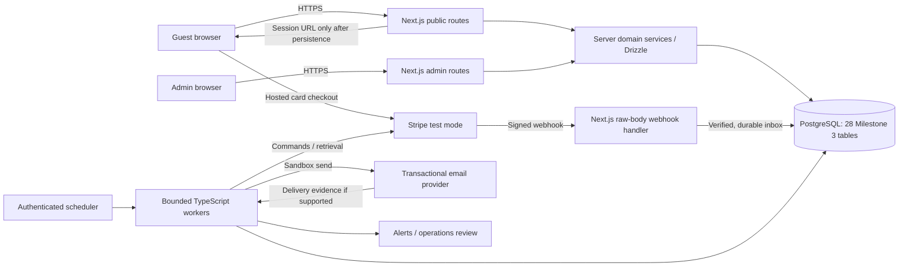
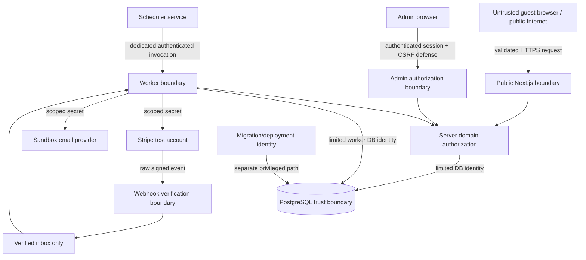
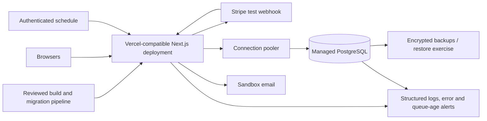

# Milestone 4 — Architecture and threat model

**Status:** Proposed implementation architecture and security contract; documentation only. This portfolio has fictional units and synthetic guests, uses Stripe **test mode** and sandbox/test email, and has no authority to take live bookings. [The brief](PROJECT_BRIEF.md), [decisions](DECISIONS.md), [Milestone 2 domain](BOOKING_PAYMENT_SPEC.md), [state machines](BOOKING_STATE_MACHINES.md), [34 scenarios](BOOKING_ACCEPTANCE_SCENARIOS.md), and [Milestone 3 database contract](MILESTONE_03.md) remain authoritative. This document neither changes their commercial terms nor implements Milestone 5.

## 1. Component and request architecture

Deploy one TypeScript/Next.js App Router application with server-rendered guest/admin surfaces, route handlers and server-side domain services. Drizzle maps ordinary PostgreSQL access; reviewed SQL at a later milestone supplies the Milestone 3 exclusion constraint, transition/aggregate triggers and controlled transactions. PostgreSQL is the durable system of record. Stripe Checkout owns hosted card entry; the application never handles card numbers. A transactional email provider handles sandbox delivery, with the PostgreSQL outbox as the source of intended notices. Scheduled TypeScript handlers/workers can run as authenticated, bounded Vercel-compatible invocations; no in-memory queue, browser callback or single long-lived process is a source of truth. Provider, database host, email vendor, authentication implementation and scheduler details remain evaluation choices, not approved services.



| Component | Synchronous responsibility | Durable/asynchronous responsibility and limit |
| --- | --- | --- |
| Public Next.js routes | Validate input, terms and guest authority; show server-derived quote/status; atomically accept quote and acquire claim; return a persisted Checkout URL or pending status. | Success/return page can request status reconciliation but cannot confirm payment. No Stripe call inside a DB transaction. |
| Admin Next.js routes | Authenticate, authorize role and target, require reason for sensitive actions; invoke locked domain transaction. | Manual investigations, approvals and retries create audited commands; browser identity never grants direct provider/database privilege. |
| Domain service + Drizzle | Execute short, explicit transactions, fixed lock order, idempotent business keys and state guards. | Enforce provider-independent policy; Drizzle is not a substitute for PostgreSQL constraints. |
| PostgreSQL | Own accepted snapshots, one `inventory_claims` exclusion domain, verified ledger, obligations, commands, inbox, outbox and audit. | Survive handler crashes; direct constraints, triggers and uniqueness provide the Milestone 3 guarantees. |
| Stripe adapter | Create/retrieve/expire test Checkout Sessions and create/retrieve refunds under persisted commands. | Return data is evidence to reconcile; a timeout is unknown. Only verified current objects drive money and booking transitions. |
| Webhook handler | Use Stripe SDK signature verification over the **unmodified raw request body** with timestamp tolerance enabled, then validate test-mode/account context and event identity; durably insert/deduplicate `stripe_webhook_events` before success response. | A worker fetches current provider objects. Bad signature/environment is denied and monitored; DB failure returns retryable error. |
| Scheduler/workers | Authenticated invocation only, bounded batch/time and concurrency; the selected execution mechanism must invoke often enough for Checkout reconciliation, confirmation and hold cleanup. | Claim due rows, reconcile provider state, send notices and alert on stuck cases. Missed, delayed or duplicate invocations recover from durable PostgreSQL records; at-least-once processing is assumed. |
| Email adapter | No booking or payment authority. | Lease `notification_outbox`, record `notification_delivery_attempts`, provider response/unknown outcome; external exactly-once delivery is not claimed. |

```mermaid
sequenceDiagram
  participant Guest
  participant App as Next.js domain service
  participant DB as PostgreSQL
  participant Worker
  participant Stripe
  Guest->>App: Accept quote and terms
  App->>DB: Transaction: snapshot + pending booking + blocking claim + command
  DB-->>App: Commit or exclusion conflict
  Worker->>DB: Lease command; persist key/fingerprint/first submission
  Worker->>Stripe: Create test Checkout Session outside transaction
  Stripe-->>Worker: Session ID, creation/expiry, URL or unknown
  Worker->>DB: Persist provider evidence; ACTIVE/OPEN or RECONCILING
  App-->>Guest: Persisted URL or pending status
  Guest->>Stripe: Card checkout
  Stripe->>App: Signed webhook
  App->>DB: Insert verified Event ID; commit before acknowledge
  Worker->>Stripe: Retrieve Session and PaymentIntent
  Worker->>DB: Reconcile; unique capture + allocation + claim transfer + outbox
  Guest->>App: Return/status query (read-only)
```

The database claim starts at acceptance, before Session creation. The configured 30-minute Checkout window starts at **provider Session creation**. A claim can remain blocking beyond Session expiry while provider state is uncertain; an elapsed timer never releases it. Checkout returns only after Session details are stored. If Session creation is still pending, the synchronous response is pending status, not a speculative URL. Balance Checkout does not acquire a second inventory claim.

## 2. Trust boundaries and authority



Browser input, emailed links, webhooks before verification and scheduled HTTP requests are untrusted. Every route binds authority to a specific booking/operation **server-side**. Provider signatures grant only the right to ingest an event, not the right to skip current-object verification or financial constraints. Migration credentials never reach request handlers or workers. Deployment operators and vendor consoles are separate high-trust surfaces requiring access review.

### Guest access

- Generate manage-booking credentials with a cryptographically secure random generator (at least 256 bits); send only via the sandbox/test email channel in portfolio mode. Use opaque tokens rather than encoding booking IDs or roles into self-authorizing links. Store only a one-way token digest in `guest_access_tokens`; compare the digest in constant time where applicable, then check `booking_id`, scope, expiry and revocation on **each** request. If lookup needs keyed hashing, keep its key in secret management. A booking ID, email address or Stripe ID is never sufficient authority.
- Issue narrow scopes for viewing, paying balance and requesting cancellation; authorize the requested operation against the current booking state. Use short configurable expiry, single-use or rotation for sensitive actions, and revoke old tokens after use, sensitive changes, suspected compromise or guest request. Exact token lifetime and delivery flow are an implementation/security review gate; do not imply a link lives for the whole stay. Redact tokens from logs, analytics, referrers and error reports; set `Referrer-Policy: no-referrer` on token-bearing pages and exchange URL tokens for a short-lived secure, HttpOnly, SameSite session before navigation where feasible. Avoid third-party assets on token landing pages.
- Return uniform unauthorized/not-found responses for out-of-scope booking access, rate-limit token checks and audit denied attempts without revealing another booking. A guest cannot submit arbitrary `booking_id` to move a valid token to a different reservation. Revocation must take effect from the database, not from a stale cached claim.

### Administrator and service access

- Use an established authentication mechanism for admins with phishing-resistant MFA where feasible, a stable external subject mapped to `admin_users`, secure server sessions and explicit role checks. **No additional authentication provider is selected here**: compare a suitable managed identity option with a self-managed implementation at the authentication milestone for MFA, session revocation, auditability and operational cost. Production-style admin access must not be an unrestricted public demo.
- Roles are operations (booking/occupancy and investigations), finance (refund initiation and financial review) and administrator (identity/role management). Enforce least privilege per action and target in server services, including blocks, provider cancellation, assessment approval, refund, resend and corrective action. Stronger finance authorization and reason/evidence are required for refund creation. A finance role alone does not override approved commercial limits. Privileged actions and denials write redacted `audit_events`.
- Protect cookie-authenticated mutations with SameSite cookies plus CSRF tokens or strict same-origin `Origin` checking, and recheck session, role, account enabled state and booking/unit target at mutation time. Rotate/revoke sessions after role changes or compromise; never trust UI hiding. Workers use dedicated scheduler invocation secrets or platform service identity and separate scoped Stripe/email credentials. Rotate secrets with overlap only where provider supports it; audit rotation and disable old credentials.
- Propose distinct DB login roles for runtime app, workers, read-only operations and migrations. Grant only required schemas/tables or controlled routines, deny public schema creation and blanket table mutation, enforce TLS to database and segregate migration privilege. PostgreSQL constraints still protect shared inventory/money; server authorization supplies guest/admin policy. Evaluate row-level security or controlled SQL routines before implementing broad direct access, especially for cross-booking reads.

## 3. Structured STRIDE threat register

Severity is a design assessment for a synthetic-data/test-payment deployment: **High** can corrupt booking/money state or expose control credentials; **Medium** can disclose synthetic data, impair availability or mislead operations. Reassess before any real guest data or live payment use. S/T/R/I/D/E = spoofing, tampering, repudiation, information disclosure, denial of service, elevation of privilege.

| ID / type / severity | Asset and attack path | Prevention | Detection and recovery |
| --- | --- | --- | --- |
| T01 S/D · Medium | Public quote/hold endpoint: bots enumerate dates or consume scarce inventory with unpaid Sessions. | Per-IP/account/operation rate and concurrency limits, bot friction as needed, bounded hold creation, signed server quote and single usable attempt; exclusion still arbitrates. | Hold-creation/expiry ratios and rate alerts; reconcile provider then release terminal-unpaid claims, block abusive sources without releasing uncertain claims. |
| T02 T/E · High | Price, dates or capacity altered in browser request or stale quote. | Server recomputation/validation, accepted immutable snapshot, versioned rates, EUR integer cents, transactionally acquired `inventory_claims`; never trust client availability. | Compare provider amount/metadata with snapshot, audit mismatch, quarantine payment and refund if unallocatable. |
| T03 S/I/E · High | Stolen or guessed guest manage-link opens another booking or cancels it. | 256-bit opaque token, hashed storage, scoped short expiry, rotation/revocation, server binding to booking and state, no token logging, rate limits. | Denied-access audit, unusual token use alerts; revoke tokens/sessions, contact affected synthetic account, review actions and repair through audit. |
| T04 S/E/R · High | Stolen admin session or role parameter triggers block/refund/assessment. | MFA-capable identity, server session and role checks, finance separation, target-level authorization, reason/evidence, CSRF defense. | Immutable actor/action audit and unusual refund/block alerts; disable identity, revoke sessions/keys, reconcile provider and inventory, correct under audited procedure. |
| T05 S/T · High | Forged webhook or replayed Event ID claims payment/refund. | Raw-body Stripe signature and environment/account verification, unique Event ID, current Session/PaymentIntent/Refund retrieval, unique provider-object ledger keys. | Invalid-signature/replay metrics and mismatched-object alerts; reject spoof, replay safe verified inbox, investigate anomalous objects. |
| T06 T/R · High | Duplicate/out-of-order events or success-page redirect incorrectly confirms booking. | Redirect is read-only; reconcile current provider objects; state/version guards, unique capture/allocation, atomic claim transfer and one exclusion domain. | Ledger/inventory drift reports; replay reconciliation, classify late/unmatched capture as unallocatable, refund without displacing a new claimant. |
| T07 T/I/E · High | SQL injection, compromised runtime DB credential or overly broad SQL access reads/mutates records. | Parameterized Drizzle/SQL, validated identifiers, least-privilege DB roles, no runtime DDL, reviewed migrations, TLS and secret isolation. | DB error/access metrics, permission-denial logs, constraint alarms; rotate credentials, contain deployment, restore/repair from verified evidence. |
| T08 I · Medium | Contact data, tokens or webhook payloads leak via logs, URLs, email or backup. | Encryption for necessary contact fields, token digests, payload metadata/digest only, redaction, restricted backup access, synthetic data, no card data. | DLP/log review and secret scanning; revoke exposed tokens/keys, purge impermissible copies subject to retention review, investigate incident. |
| T09 S/T/E · High | Worker or scheduler secret compromise initiates provider POST, replays commands or releases claims. | Dedicated service identity, command leases/generation fencing, operation keys, scoped secrets, server-side transition guards, provider reconciliation before release. | Command/rate anomalies, lease age, release-without-evidence alarms; stop workers, rotate secrets, quarantine unknown operations, reconcile before resuming. |
| T10 D · Medium | Public floods, expensive range queries, webhook storms or repeated scheduler calls exhaust app/DB/provider quotas. | Edge rate limits, request/body bounds, DB indexes/timeouts, bounded worker batches/concurrency, backoff, deduplicated inbox/outbox. | Latency, queue-age, DB-connection and provider-error alerts; throttle, shed optional work, replay durable queues when capacity returns. |
| T11 E/I · High | Cross-booking or cross-unit ID substitution returns another guest's record or mutates their refund. | Every query/action scopes token/admin role to booking and target; FK/identity checks; no direct object reference as authority; negative authorization tests. | Denial and cross-scope audit; revoke credentials, inspect affected rows, correct via audited transaction and notify as appropriate. |
| T12 T/E/I · High | Malicious dependency, build secret leak or wrong deployment environment enables live keys/admin bypass. | Pin/review dependencies and provenance, CI secret isolation, protected deploy settings, separate env credentials, test-mode assertions and no live checkout configuration. | Build/deploy audit, runtime mode checks and secret scanning; roll back deployment, rotate keys, disable affected endpoint, investigate provenance. |

## 4. Payment, command and reconciliation protocol

1. Persist booking/attempt/claim and `provider_commands` in a short transaction before a Stripe call. The worker atomically claims a due command with `FOR UPDATE SKIP LOCKED`, records lease owner/expiry/generation, request fingerprint, stable Stripe key and `first_submitted_at` before first POST, then commits. Provider calls occur outside the transaction. Completion requires matching owner/generation. An expired lease allows investigation or a safe resume, **never** the inference that the POST failed.
2. Treat network timeout, lost response and failed persistence as unknown. Inspect stored provider IDs, verified events and current provider objects; attach `reconciliation_records`. Before the safe API v1 window ends, a replay can use the **same key and exact parameters** only after state inspection. Stripe API v1 keys may be pruned after 24 hours; at/after 24 hours from first submission, or if age is unknown, quarantine unresolved Session/refund creation and do not blindly POST with either old or new key. Missing search results alone do not prove absence. Authorized, evidenced investigation may close an operation as not performed before a new attempt/key is created with current inventory/refund checks. Unresolved hold remains blocking; unresolved refund remains owed/reserved.
3. A webhook route uses the Stripe SDK to verify the signature over the **unmodified raw request body** with its timestamp freshness tolerance enabled; never pass tolerance `0`, which disables the recency check. Validate test environment/account, store a unique `stripe_webhook_events` ID and minimal metadata, then acknowledge only after commit. Signature freshness is checked against **each delivery attempt's** signed timestamp, not the original Event creation time: a legitimate later Stripe retry has a new signature/timestamp and must not be rejected solely because its Event is old ([Stripe webhook security guidance](https://docs.stripe.com/webhooks#preventing-replay-attacks)). Worker processing is at least once. Retrieve current Checkout Session **and** linked PaymentIntent; require Session `payment_status=paid`, Intent `status=succeeded`, expected EUR amount, IDs/metadata and test environment before unique `payment_records` insertion. `checkout.session.completed` alone is insufficient. Unexpected async states quarantine under D19. Unknown event types record evidence without a financial transition.
4. Under the Milestone 3 lock order, an initial verified capture allocates once and transfers the **same** `inventory_claims` row from hold to booking if still eligible. A balance capture allocates without inventory change. Duplicate/out-of-order events re-read current provider state and cannot regress success. A payment after claim release, or one with no safe attempt linkage, becomes unique unallocatable/incident-owned money with a full refund obligation, never a guessed or resurrected booking. Preserve authoritative success-time evidence; if timing cannot be proved, defer nonpayment cancellation.
5. For expiry/abandon, request Session expiration where possible and reconcile Session/Intent until terminal unpaid with no success in flight before releasing claim. If still open/unpaid/unexpired and claim owned, recover `RECONCILING → ACTIVE` hold and `RECONCILING → OPEN` initial attempt together; balance attempts recover `RECONCILING → OPEN` without a hold. If uncertain, remain blocking and alert.
6. Refund commands reserve both obligation and source-capture budgets before POST. Only provider-confirmed success creates unique `refund_records` and a guest notice where identity is known; confirmed failure releases reservations while leaving liability owed; unknown outcome retains reservation and `PROCESSING`. Assessment revisions use latest approved charge, verified captures, confirmed refunds and **all** outstanding obligation residuals including unsent/in-flight amounts, under booking/assessment locks and unique revision keys. Example: €120 paid, €50 approved charge creates €70 liability; lowering charge to €20 before submission creates only €30 more, €100 total. No automatic advance forfeiture or charge after cancellation.

PostgreSQL directly enforces half-open overlap via the **single** `inventory_claims` partial GiST exclusion domain across holds, bookings and operator blocks; uniqueness, FKs, checks and specified triggers/parent locks protect ledger budgets and transition shape under `READ COMMITTED`. Application routines enforce authorization, provider truth, policy and fixed lock order; a signature or database evidence row cannot prove Stripe funds by itself. Concurrent payment allocations must lock obligation then capture parents deterministically before deferred aggregate checks. A competing-allocation test (two €60 allocations against one €100 obligation) must leave at most €60 committed, as specified in [Milestone 3](MILESTONE_03.md). Database transaction retries never imply provider POST retries.

## 5. Scheduled work and notification reliability

Use short authenticated scheduled invocations that claim limited batches from durable PostgreSQL rows, commit a lease, work outside the transaction, then conditionally commit results. The selected scheduler or equivalent reliable execution mechanism must invoke often enough for timely Checkout reconciliation, booking confirmation and inventory-hold cleanup; a **daily-only** schedule cannot be the sole processing mechanism. Webhooks may initiate prompt reconciliation, but delivery/processing can fail, so scheduled recovery must independently drain outstanding work. Provider and plan selection remain open; no latency SLA is set here. `provider_commands` use owner/expiry/generation; notification outbox uses `lease_until` and uniquely numbered delivery attempts. For other due scans (hold, balance deadline, stale inbox), use row locks/`SKIP LOCKED` or compare-and-set versions; a duplicate scheduler invocation must be harmless. A delayed or failed invocation leaves work durable; later invocations scan overdue rows, reclaim expired leases safely and retry database work by stable key. A crash before commit rolls back, after commit replays by stable key, and after an external call creates an **unknown outcome** requiring reconciliation. Lease expiry or a delayed run never proves Stripe failure or authorizes inventory release. Set per-call timeouts, exponential backoff with jitter, bounded retry count and a visible poison/stuck queue with operations alert and manual disposition. Monitor oldest due/unfinished row and last successful worker run; alert on growing queue age, missed runs and prolonged blocking holds. A permanently failing record is never silently deleted.

| Work | Eligibility and safe effect | Stale/unknown result |
| --- | --- | --- |
| Balance warning at `W = A − 21 calendar days` | Confirmed advance booking, balance outstanding; if accepted in `[W,D)`, enqueue once promptly and state actual remaining lead. | Suppress unsent/retry warning if paid/cancelled or `t >= D`; never claim it was sent seven days early when it was not. |
| Due at `D = A − 14 calendar days` | Queue once if balance outstanding; booked locale and exact property-local deadline. | Late run evaluates current state; no due notice after paid/cancelled status. |
| Overdue strictly after `D` | Queue once if outstanding, showing `G = D + 24 elapsed hours`. | A reminder/notice does not start a new grace period or cancel a booking. |
| Governed nonpayment at/after `G` | Reconcile **all** balance attempts, expire open Sessions where possible, prove terminal unpaid and reliable success time, then locked recheck and atomic cancellation/claim release. | Processing/unknown provider state defers and alerts. The full-refund/zero-charge outcome remains a **proposed, commercially unapproved** default; no fee is invented. |
| Hold/session sweep | Inspect `CREATING`, `ACTIVE`, `RECONCILING` and provider command age; retrieve/expire Session and linked Intent. | Clock-only expiry never releases claim; open/unpaid/unexpired can recover same Session; uncertain state stays blocking. |
| Refund sweep | Retrieve in-flight refund and reconcile reservation/provider status; re-evaluate remaining obligation before a new attempt. | Unknown outcome stays `PROCESSING` and reserved; API v1 boundary quarantines blind retry. |
| Notification sender | Recheck relevance under lease, render equivalent `lt/en/de` content, send sandbox message, record provider ID/attempt. | Unknown send is reconciled with provider where possible; retry may duplicate external email if provider lacks idempotency. Unique outbox key guarantees one logical notice, **not** exactly-once delivery. |

Use `Europe/Vilnius` calendar arithmetic for `W` and `D` from configured local check-in time (15:00 remains **provisional**, D12), store UTC-compatible `timestamptz` instants, and calculate `G` as 24 elapsed hours. Never subtract fixed `21 × 24h` or `14 × 24h` across daylight-saving changes. Use a database/server clock for eligibility and compare authoritative provider success time rather than webhook receipt time. The March and October 2027 examples in Milestone 2 are implementation test fixtures, not new policy.

## 6. Deployment, observability and recovery

The minimal **proposed** topology is a Vercel-compatible Next.js deployment, managed PostgreSQL reachable through a connection pool compatible with short serverless invocations, scheduled authenticated TypeScript handlers, Stripe test account and a sandbox transactional email service. Vercel compatibility is approved direction; the actual PostgreSQL host, pooler, email vendor, identity service, scheduler plan and alerting service require evaluation for region, security, reliability and cost. No standing worker or separate queue service is required by this design because PostgreSQL contains the durable work records.

**Scheduler feasibility:** [Vercel's current cron limits](https://vercel.com/docs/cron-jobs/usage-and-pricing) allow Hobby jobs only once per day, while Pro supports a minimum interval of once per minute. Hobby's daily cron alone cannot meet this architecture's timely Checkout reconciliation, confirmation and hold-cleanup needs. A sufficiently frequent scheduler or equivalent reliable execution mechanism is an implementation gate, without choosing a provider or paid plan here. [Vercel cron expressions use UTC and target the production deployment](https://vercel.com/docs/cron-jobs); local and preview validation must explicitly call the **authenticated** worker handlers rather than assume cron runs there ([Vercel local invocation guidance](https://vercel.com/docs/cron-jobs/manage-cron-jobs)). Vercel cron delivery is best effort and failed invocations are not automatically retried; persistent PostgreSQL work, catch-up scans, safe idempotent retries, queue-age/last-run alerts and manual escalation cover missed or delayed invocations. These mechanisms do not shorten the provider-reconciliation barrier for releasing inventory.



| Area | Proposed control and operational check |
| --- | --- |
| Environment separation | Distinct development/test/portfolio-deployment database, Stripe test account/keys/endpoints, email sandbox and secrets; separate deployment configuration and data. No live Stripe keys or real guest data in any environment. Assert test mode at startup/command and reject live-mode events. Production environment here means the public **portfolio runtime**, not approved live commerce. |
| Connections and migrations | Pool and cap concurrent DB connections for serverless execution; use transaction-compatible pooling for explicit locks and short transactions. Separate migration identity from runtime; version-controlled reviewed migrations start at Milestone 5, with backup/rollback plan and post-migration invariant checks. No automatic runtime DDL. |
| Secrets and transport | Platform secret store, least privilege, TLS to provider/DB, no secret in browser bundle, source, logs or build artifacts. Inventory secret owners, rotation steps and emergency revocation. Restrict webhook and scheduler endpoints to their independent authentication mechanisms. |
| Logs and monitoring | Correlation IDs, operation keys and object IDs rather than contact data or raw webhook body. Monitor webhook verification/processing, stale commands/leases, claim age, refund reservations, outbox age, DB constraint errors, pool pressure, provider errors, backup age and restore result. Alert with owner and escalation path. |
| Health | Liveness confirms handler startup; readiness/dependency checks with bounded DB/provider checks where appropriate. A healthy HTTP response does **not** prove queues are draining: alert on oldest unprocessed verified event, command, hold, refund and critical notice. |
| Backups | Managed encrypted backups and point-in-time recovery if supported by chosen host; restricted access, recorded retention, periodic restore to isolated environment and checks of inventory/ledger/outbox counts and constraints. Define actual policy with provider and privacy review; do not call an untested backup recoverable. |

**Proposed recovery objectives, not approved commitments:** target RPO ≤ 15 minutes if the chosen PostgreSQL host provides and validates point-in-time recovery, and RTO ≤ 4 hours for a database restore exercise. These are design targets to validate against provider capabilities, cost, incident staffing and measured restore drills before approval. Stripe/email external state needs post-restore reconciliation; DB restore alone cannot guarantee cross-system consistency. Until measured, report actual recovery capability as unknown.

| Failure | Containment and recovery runbook |
| --- | --- |
| App or DB unavailable | Stop new checkout creation and privileged mutations; show unavailable/pending state without claiming payment failure. Restore DB/service, re-establish webhook ingestion, drain durable inbox/commands, reconcile provider objects before reopening booking writes. |
| Webhook outage or backlog | Return retryable error if verified event cannot commit; replay provider delivery where supported and sweep open attempts/current objects. Deduplicate by Event ID and provider-object IDs; compare ledger to Stripe test records. |
| Unknown Session creation / held claim | Quarantine command if key age unsafe; keep claim blocking, identify Session and linked payment from provider evidence, recover same open Session or release only after terminal-unpaid proof. Escalate aged cases. |
| Late payment / inventory conflict | Preserve new claimant; record captured money as unallocatable/incident-owned, notify operations/guest where identified and create traceable full refund. Do not resurrect booking. |
| Refund uncertainty | Keep reservation and liability; inspect refund/charge/provider records, quarantine at key boundary, authorize documented resolution or replacement attempt only after proof. Never mark refunded from request alone. |
| Email provider outage or uncertain send | Keep booking/money committed, preserve outbox/attempt history, retry with bounded backoff after provider lookup where possible; alert and manually handle critical failed notice. Do not assert exactly-once delivery. |
| Database restore or suspected compromise | Isolate credentials and writes, restore verified backup to separate environment, inspect constraints and immutable ledgers, compare provider test records and inbox/outbox, replay idempotently, document corrections and rotate credentials before return. Never overwrite history to hide divergence. |

## 7. Privacy and security operations

Store only synthetic guest contact data and minimal test-mode provider IDs. Encrypt necessary contact fields at rest with application-managed keys from secret storage, use a keyed digest only for required lookup, and keep raw card data, manage tokens, full webhook payloads and secrets out of PostgreSQL/audit/logs. Restrict backup access and define a retention/deletion schedule for contact data, provider evidence, notices and audit records before real use; financial/audit preservation and deletion rights need expert review. Redact free-text reasons/evidence and use controlled references rather than personal documents. Limit analytics and error reporting to non-sensitive identifiers.

Use HTTPS/HSTS where supported, secure HttpOnly SameSite cookies, CSP and output escaping to reduce XSS, CSRF defense for cookie-authenticated mutations, explicit CORS/origin policy and restrictive cache headers for guest/admin pages. Rate-limit public booking, token checks, auth and webhook endpoints with bounded request sizes; do not rate-limit verified Stripe retry traffic into permanent loss. Keep dependencies reviewed/pinned and deployment environment assertions test-mode only. Maintain an incident log, access/secret revocation procedure, backup restore drill and route to suspend checkout if an invariant or credential is compromised. These are implementation requirements and proposals, not claims of certification or legal compliance.

Before live commerce, qualified Lithuanian review is required for consumer terms, cancellation and refund timing, privacy notices/retention and lawful processing, tax/price presentation, operator registration and e.turistas obligations as applicable. No real address, property certification, guest feedback, revenue or operating authorization is asserted. The provisional check-in time, exact token lifetime, admin identity choice and proposed recovery objectives remain open.

## 8. Guarantee mapping, acceptance and open gates

| Source guarantee | Architecture mechanism / implementation evidence needed |
| --- | --- |
| Milestone 2 booking/inventory and scenarios 1–3, 16–21, 29–34 | One PostgreSQL `inventory_claims` exclusion domain, immutable accepted price snapshot, persisted command/Session timings, verified initial/balance capture and atomic ownership transfer; concurrency, late/duplicate/out-of-order and open-Session recovery tests in later milestones. |
| Milestone 2 financial policy and scenarios 7–15, 23, 26 | Integer EUR cents and approved split; conditional late assessment with immutable lower revisions; verified refund reservation/ledger; pending nonpayment commercial approval; provider refund fault tests later. |
| Milestone 2 timing/notices and scenarios 4–8, 22, 24–25, 33 | `Europe/Vilnius` W/D/G instants, late accepted warning with actual lead, obsolete-warning suppression, durable outbox/attempts and duplicate scheduler runs; DST, late-run and uncertain-email tests later. |
| Milestone 2 security and scenarios 27–28 | Scoped guest token, role-specific admin authorization, service identity and redacted denied-access audit; cross-booking, token replay and role-denial tests later. |
| Milestone 3 database contract | All 28 tables remain the durable model; no additional table is required here. Single partial GiST inventory exclusion, parent-locked allocation budgets, unique operation/evidence keys, lease fencing and refund obligations remain the authoritative persistence design. |

### Security and operational acceptance checklist for later implementation

- [ ] Map every route, worker and provider adapter to a scoped identity; exercise denied guest/admin, CSRF, token expiry/revocation and cross-booking cases.
- [ ] Verify raw-body webhook signature, wrong-mode/account rejection, durable acknowledge, duplicate/out-of-order processing and current-object amount/identity checks in Stripe test mode.
- [ ] Prove one inventory exclusion domain against overlapping guest holds, confirmations and operator blocks; test crash/expiry/late capture and no release on uncertainty.
- [ ] Test `READ COMMITTED` payment allocation race, refund reservation/revision race and provider-command lease takeover without duplicate external POST.
- [ ] Validate API v1 ≥24-hour/unknown-age quarantine, provider identification and documented manual resolution for Session/refund unknown results.
- [ ] Verify the selected scheduler's invocation frequency and authenticated local/preview worker calls; fault-test missed, delayed, failed and duplicate runs, overdue-row catch-up, queue-age alerts and no claim release before authoritative reconciliation.
- [ ] Test Stripe SDK signature verification with freshness tolerance enabled (never `0`), including a stale signed delivery and a legitimate retry of an older Event with a fresh delivery signature/timestamp.
- [ ] Test W/D/G and DST, late confirmation in `[W,D)`, obsolete warning suppression, overdue grace and notification unknown-send behavior.
- [ ] Review sandbox email/Stripe/DB secret isolation, log redaction, database permissions, backup restore and provider-vs-ledger reconciliation.
- [ ] Measure queue age/alerts and restore objectives; rehearse outage, credential compromise, poison message and late-payment conflict runbooks.

**Open decisions and implementation gates:** D12 check-in time remains provisional; D17 rates/fees/taxes, D18 live legal/registration review, D19 async payment method policy and D20 reporting remain unresolved. The conservative full-refund/zero-charge nonpayment rule remains a **commercially unapproved proposal**. Validate Stripe Session expiry, authoritative success-time evidence, refund-object identification, webhook signature freshness/retry behavior and API v1 retry behavior in test mode before automating cancellation/recovery. Select and validate admin authentication, transactional email, PostgreSQL/pooler, sufficiently frequent scheduler or equivalent execution mechanism, and monitoring providers; set token/session lifetimes, security headers, data retention, recovery owners and measured RPO/RTO before deployment approval. Verify PostgreSQL/Drizzle trigger and role behavior during later migration/testing milestones. No PHP, application code, migrations, package installations, frontend implementation or commits are part of Milestone 4.
