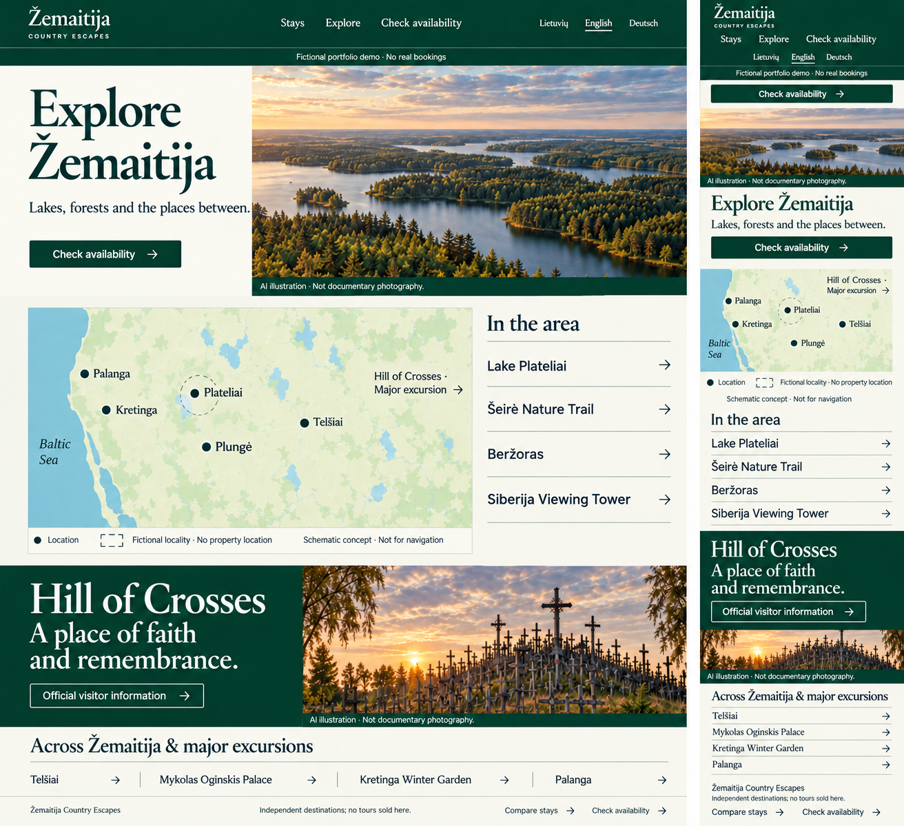
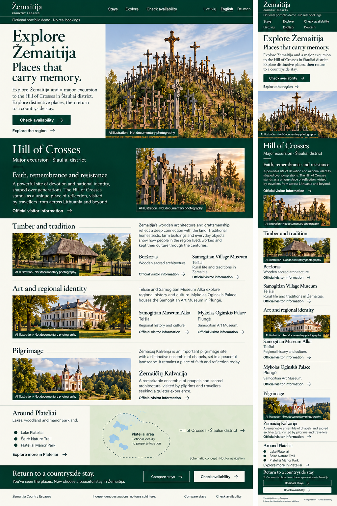
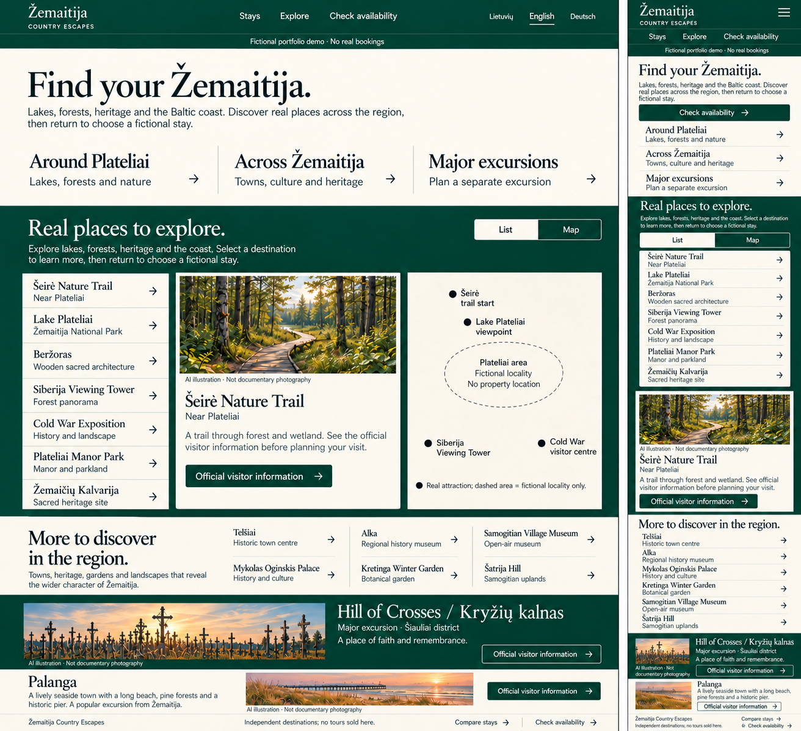

# Explore Žemaitija · three concepts for review

**Milestone 17, Phase A · Unapproved design concepts · 27 October 2026**

Start with the [complete review handover](REVIEW_HANDOVER.md).

| Concept | Desktop and mobile composition | Character |
| --- | --- | --- |
| **A — Landscape Atlas · recommended** | [View full-resolution board](a-landscape-atlas.png) | Landscape, regional orientation, ruled destination index. |
| B — Cultural Journey | [View full-resolution board](b-cultural-journey.png) | Hill of Crosses lead story, architecture, museums, pilgrimage. |
| C — Regional Field Guide | [View full-resolution board](c-regional-field-guide.png) | Three geographic scopes, destination selection, map/list discovery. |

The boards contain generated illustrative images and schematic maps. They are not documentary attraction photographs, verified navigation maps or implemented interfaces. Review the [17-destination inventory](DESTINATIONS.md), [map proposal](MAP.md), [image rights/provenance](IMAGE_PROVENANCE.md), [local critique](REVIEW.md) and [artifact manifest](ARTIFACTS.json) alongside them.

**Selection remains open.** Select, combine, revise or reject the concepts after independent review. A needs its explicit Hill of Crosses district qualifier restored beside the feature; C needs visible mobile languages, a larger mobile Hill feature and clear list/map behaviour. Raster typography remains approximate. All approval conditions and further decisions are in the handover. Phase B requires explicit user approval; no application code has been changed.
